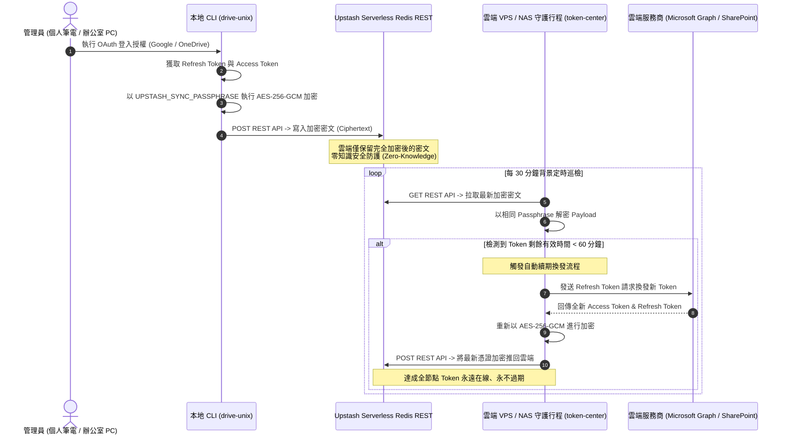

# drive-unix 生產級全方位佈署指南 (Production Deployment Manual)

本手冊為 `drive-unix` 多雲端儲存管理、即時傳輸同步與自動化憑證換發系統的官方生產級佈署指南。內容涵蓋系統架構設計、三種核心執行拓撲（Docker 容器化、Linux Systemd 守護行程、本機/Windows）、NAS 私有雲（Synology DSM / QNAP QTS）儲存與權限對齊、Nginx 與 Caddy 2 反向代理安全強化（含 Server-Sent Events 串流優化技術解析）、Upstash E2EE 跨節點端對端加密憑證管理，以及自動化腳本維運與常見故障排錯矩陣。

---

## 目錄 (Table of Contents)

1. [系統架構概觀與先決條件 (System Architecture Overview & Prerequisites)](#1-系統架構概觀與先決條件)
   - 1.1 系統架構與元件佈局
   - 1.2 端到端系統架構與資料流向圖 (Mermaid Diagrams)
   - 1.3 硬體規格需求 (Hardware Requirements)
   - 1.4 軟體環境依賴 (Software Requirements)
   - 1.5 連接埠與防火牆存取規則 (Network & Firewall Rules)
2. [三種核心佈署拓撲實務 (Three Core Deployment Topologies)](#2-三種核心佈署拓撲實務)
   - 2.1 拓撲方案綜合比較矩陣
   - 2.2 方案 A (推薦容器化)：Docker 與 Docker Compose
   - 2.3 方案 B (傳統 Linux 服務)：Systemd 守護行程
   - 2.4 方案 C (本機 / Windows / 輕量執行)：原生虛擬環境與工作排程
3. [私有雲與 NAS (Synology / QNAP) 掛載指引 (Private Cloud & NAS Mounts)](#3-私有雲與-nas-synology--qnap-掛載指引)
   - 3.1 NAS 權限模型核心痛點：UID/GID 與 ACL 衝突解析
   - 3.2 Synology DSM (群暉科技) 實務設定
   - 3.3 QNAP QTS (威聯通科技) 實務設定
   - 3.4 網路儲存協定 (WebDAV / SFTP) 對齊與自簽憑證信任
4. [反向代理與安全強化 (Reverse Proxy & Security Hardening)](#4-反向代理與安全強化)
   - 4.1 Nginx 反向代理設定 (`deploy/nginx/drive-unix.conf`)
   - 4.2 技術根因深入解析：為何 SSE 必須完全關閉 `proxy_buffering`？
   - 4.3 前端靜態資源快取策略
   - 4.4 大檔案上傳配置與逾時保護
   - 4.5 SSL/TLS 憑證與安全標頭配置
   - 4.6 Caddy 2 等效反向代理配置 (`Caddyfile`)
5. [Upstash E2EE 憑證同步與生產密鑰管理 (Upstash E2EE & Secret Management)](#5-upstash-e2ee-憑證同步與生產密鑰管理)
   - 5.1 Upstash Serverless Redis REST 建立與設定步驟
   - 5.2 端對端加密 (E2EE) 運作原理與主密碼 (Passphrase) 關鍵安全警訊
   - 5.3 生產環境變數與安全密鑰治理最佳實踐 (12-Factor App)
   - 5.4 跨多台節點憑證同步架構圖 (Mermaid Diagram)
6. [維運、自動化腳本與常見問題排錯矩陣 (Operations & Troubleshooting)](#6-維運自動化腳本與常見問題排錯矩陣)
   - 6.1 自動化維運腳本 `scripts/deploy.sh` 完整操作手冊
   - 6.2 系統即時日誌檢視指令 (Docker, Systemd, 本機檔案)
   - 6.3 生產環境常見故障排錯矩陣 (Troubleshooting Matrix)

---

## 1. 系統架構概觀與先決條件

### 1.1 系統架構與元件佈局

`drive-unix` 採用 Clean Architecture（整潔架構）設計原則，核心功能劃分為以下主要層級與元件：

1. **核心領域與設定層 (`core/`)**：
   - 集中定義系統組態模型 (`config.py`)、密鑰儲存庫 (`secrets.py`)、AES-256-GCM 與 PBKDF2 加密模組 (`crypto.py`)，以及防止目錄遍歷逃逸的路徑檢查器 (`paths.py`)。
2. **多雲端儲存提供者抽象層 (`storage/` & `providers/`)**：
   - 定義標準化 `StorageProvider` 介面，統一管理 Google Drive、Microsoft OneDrive、SharePoint、WebDAV、SFTP、Alist、PikPak 及本地檔案系統（Local FS）。
3. **業務應用編排層 (`application/`)**：
   - 包含高併發多工作緒檔案傳輸服務 (`transfer_service.py`)、多批次目錄同步引擎 (`sync_service.py`)、背景 Cron 排程守護行程 (`scheduler_daemon.py`)，以及 Upstash 分散式鎖與 Token 自動換發服務 (`upstash_token_service.py`)。
4. **FastAPI Web 伺服器與 REST API (`web/`)**：
   - 基於 FastAPI 與 Uvicorn，預設監聽連接埠 `8000`。
   - 具備記憶體環狀緩衝（Ring Buffer）與 15 秒心跳機制的 SSE 事件廣播系統 (`web/events.py`)，提供即時進度推播端點 `/api/events` 與 `/api/sync/tasks/{task_id}/events`。
   - 靜態檔案掛載器 (`SPAStaticFiles`)，直接自 `web/static/` 託管現代化 React SPA 控制台，並支援前端深層路由回退 (Fallback to `index.html`)。
5. **瀏覽器自動化換發模組 (`auth/providers/sharepoint_cookie.py`)**：
   - 整合 Playwright Headless Chromium，在無桌面環境的伺服器上全自動處理 Microsoft SharePoint 與 OneDrive 商務版之複雜驗證碼、多重要素驗證（MFA）與連線 Cookie 換發。

---

### 1.2 端到端系統架構與資料流向圖 (Mermaid Diagrams)

#### 架構圖 A：生產環境端到端系統全景拓撲

```mermaid
graph TB
    subgraph ClientLayer [客戶端層]
        Browser["現代化瀏覽器 (React 18 SPA)"]
        CLIClient["drive-unix CLI 終端指令"]
    end

    subgraph ReverseProxyLayer [反向代理層 (DMZ / Public Network)]
        Proxy["Nginx 或 Caddy 2 反向代理伺服器<br/>監聽 Port 80 / 443 (Let's Encrypt SSL/TLS)"]
        StaticCache["靜態資產快取 (/assets/* 30天)"]
        SSEBlock["SSE 串流零緩衝通道<br/>(proxy_buffering off; timeout 86400s)"]
    end

    subgraph AppServerLayer [應用伺服器層 (Private Network / Container)]
        direction TB
        FastAPIServer["FastAPI Web 伺服器 (Uvicorn)<br/>監聽 127.0.0.1:8000 (容器內 0.0.0.0:8000)"]
        
        subgraph WebModules [Web 核心模組]
            SPAStatic["SPAStaticFiles<br/>(web/static/index.html)"]
            EventBroadcaster["EventBroadcaster<br/>(15s 心跳 / 500筆重放佇列)"]
            TaskRegistry["TaskEventManager<br/>(任務進度追蹤)"]
            BandwidthLimiter["TokenBucket 限速器"]
        end

        subgraph BackgroundServices [常駐守護行程]
            TokenDaemon["Upstash Token Renewal Daemon<br/>(每 30 分鐘自動換發)"]
            SchedulerDaemon["Cron 排程器常駐行程"]
            PlaywrightChromium["Playwright Headless Chromium<br/>(SharePoint Cookie / MFA 換發)"]
        end
    end

    subgraph StorageAndSyncLayer [儲存與遠端雲端同步層]
        LocalDisk[("本地硬碟 / NAS 掛載目錄<br/>/data 與 ~/.config/drive-unix")]
        UpstashRedis[("Upstash Serverless Redis<br/>(AES-256-GCM E2EE 加密同步)")]
        GoogleDrive["Google Drive API"]
        MicrosoftGraph["Microsoft Graph / OneDrive / SharePoint"]
        PrivateNAS["私有雲 / NAS (WebDAV / SFTP)"]
    end

    %% 連線關聯
    Browser -->|HTTPS 443| Proxy
    CLIClient -->|本機指令 / REST| FastAPIServer
    Proxy -->|靜態快取命中| StaticCache
    Proxy -->|串流直通| SSEBlock
    Proxy -->|反向轉發| FastAPIServer

    FastAPIServer --> SPAStatic
    FastAPIServer --> EventBroadcaster
    FastAPIServer --> TaskRegistry
    FastAPIServer --> BandwidthLimiter

    EventBroadcaster -.->|SSE 串流推播 /api/events| SSEBlock
    TokenDaemon -->|自動登入與抓取 Cookie| PlaywrightChromium
    TokenDaemon -->|E2EE 加密讀寫| UpstashRedis

    FastAPIServer -->|讀寫本機快取與設定| LocalDisk
    FastAPIServer -->|多雲端同步與傳輸| GoogleDrive
    FastAPIServer -->|多雲端同步與傳輸| MicrosoftGraph
    FastAPIServer -->|多雲端同步與傳輸| PrivateNAS
```

#### 架構圖 B：Server-Sent Events (SSE) 即時事件串流資料流

```mermaid
sequenceDiagram
    autonumber
    actor User as 使用者瀏覽器 (SPA)
    participant Nginx as Nginx / Caddy 反向代理
    participant FastAPI as FastAPI / Uvicorn (Port 8000)
    participant Broadcaster as EventBroadcaster (web/events.py)
    participant Transfer as 傳輸與同步工作緒 (TransferService)

    User->>Nginx: GET /api/events (HTTP/1.1 or HTTP/2)
    Note over Nginx: proxy_buffering off;<br/>proxy_read_timeout 86400s;
    Nginx->>FastAPI: GET /api/events (Connection: keep-alive)
    FastAPI->>Broadcaster: 訂閱廣播串流 (Last-Event-ID)
    Broadcaster-->>FastAPI: event: hello (server_time, replayed: false)
    FastAPI-->>Nginx: HTTP 200 (X-Accel-Buffering: no, text/event-stream)
    Nginx-->>User: 即時轉發 hello 事件 (零緩衝延遲)

    loop 定期背景同步或傳輸任務進行中
        Transfer->>Broadcaster: 推送進度事件 (task.update: speed, percent, bytes)
        Broadcaster-->>FastAPI: 格式化 SSE 區塊 (節流 250ms)
        FastAPI-->>Nginx: 分塊資料封包 (Chunked Transfer)
        Nginx-->>User: 即時抵達瀏覽器 -> 畫面進度條平滑前進
    end

    opt 無傳輸活動靜止狀態
        Broadcaster-->>FastAPI: event: heartbeat (每 15 秒定時發送)
        FastAPI-->>Nginx: heartbeat 封包
        Nginx-->>User: 維持 TCP 連線活性，防止防火牆中斷長連線
    end
```

---

### 1.3 硬體規格需求 (Hardware Requirements)

硬體配置視是否啟用 **SharePoint Headless 登入換發（Playwright Chromium）** 及 **多雲端並行傳輸工作緒數量** 而定：

| 配置層級 | CPU 規格 | 記憶體 (RAM) | 硬碟空間 (Disk) | 適用場景 |
| :--- | :--- | :--- | :--- | :--- |
| **最低運行需求**<br/>(Minimal) | 1 核心 (vCPU) | 1.0 GB | 10 GB SSD | 僅執行輕量 Web 控制台、REST API、本機同步與基本 CLI，**停用** Playwright 瀏覽器自動登入。 |
| **推薦生產規格**<br/>(Recommended) | 2 核心 (vCPU) | 2.0 GB ~ 4.0 GB | 30 GB+ NVMe SSD | 啟用 Playwright Chromium 自動換發 SharePoint Cookie、4~8 個並行傳輸工作緒、大規模目錄快取與多節點同步。 |
| **企業大規模叢集**<br/>(Enterprise) | 4 核心以上 | 8.0 GB 以上 | 100 GB+ 高速儲存 | 多使用者高頻繁同步、數十萬個檔案的中繼資料 SQLite 快取管理、大型多媒體檔案備份。 |

*註：在 1GB 記憶體之低階 VPS 上若需啟動 Playwright，強烈建議建立 2GB 以上之 Linux Swap 交換空間，避免 Chromium 啟動瞬間觸發 Linux OOM Killer。*

---

### 1.4 軟體環境依賴 (Software Requirements)

生產環境主機需預先具備以下底層環境：

1. **作業系統 (OS)**：
   - Linux: Ubuntu 22.04 LTS / 24.04 LTS、Debian 12 (Bookworm)、Rocky Linux 9、Synology DSM 7.2+、QNAP QTS 5.0+。
   - macOS: macOS 13+ (Ventura / Sonoma / Sequoia)。
   - Windows: Windows 10/11 專業版或 Windows Server 2022。
2. **Python 執行環境**：
   - 嚴格要求 **Python >= 3.12**（專案已於 Python 3.12.13 完整驗證）。
3. **容器化工具（方案 A 推薦）**：
   - Docker Engine >= 24.0。
   - Docker Compose v2 (支援 `docker compose` CLI 外掛)。
4. **前端資產編譯相依性說明（重要）**：
   - 本專案已將 React 18 + Vite + Tailwind CSS 4 編譯產物完整收錄於 `web/static/` 目錄中。
   - **在生產環境執行與佈署時，伺服器「不需要」安裝 Node.js 或 npm**。FastAPI 的 `SPAStaticFiles` 將直接高效託管這些預先構建之靜態資產。僅在您需要自行修改 `frontend/` 原始碼並重新編譯時，才需要 Node.js >= 18。
5. **反向代理伺服器**：
   - Nginx >= 1.20 (建議 1.24+)，或 Caddy >= 2.6。
6. **瀏覽器圖形相依庫（僅非容器環境需注意）**：
   - 若在原生 Linux 執行 Playwright Chromium，系統需具備：`libnss3`, `libatk1.0-0`, `libatk-bridge2.0-0`, `libcups2`, `libdrm2`, `libxkbcommon0`, `libxcomposite1`, `libxdamage1`, `libxfixes3`, `libxrandr2`, `libgbm1`, `libpango-1.0-0`, `libasound2`。

---

### 1.5 連接埠與防火牆存取規則 (Network & Firewall Rules)

#### 入站連接埠 (Inbound Ports)

| 連接埠 | 協定 | 監聽對象 | 用途與存取建議 |
| :--- | :--- | :--- | :--- |
| **80** | TCP | 反向代理 (Nginx/Caddy) | HTTP 服務，用於 Let's Encrypt ACME 憑證驗證與轉導至 443。 |
| **443** | TCP | 反向代理 (Nginx/Caddy) | HTTPS 主服務連接埠，對外提供 Web 管理控制台與 REST API 存取。 |
| **8000** | TCP | `drive-unix` 後端 | FastAPI Web 伺服器預設連接埠。<br/>• **反向代理模式**：應僅綁定 `127.0.0.1:8000`，**嚴禁**對公網直接暴露。<br/>• **Docker 容器內部**：監聽 `0.0.0.0:8000`，由 Docker 連接埠映射控制。 |

#### 出站網路存取需求 (Outbound Firewall Permissions)

`drive-unix` 作為多雲端排程引擎，需要對外連線存取以下端點（均使用 TCP 443）：

- **Google Drive / Google Photos**：`accounts.google.com`, `oauth2.googleapis.com`, `www.googleapis.com`。
- **Microsoft 365 / OneDrive / SharePoint**：`login.microsoftonline.com`, `graph.microsoft.com`, `*.sharepoint.com`。
- **Upstash Serverless Redis**：`*.upstash.io` (REST API 端點)。
- **私有雲 / NAS 目標端點**：自訂 WebDAV（如 5005, 5006）或 SFTP（TCP 22）連接埠。

---

## 2. 三種核心佈署拓撲實務

### 2.1 拓撲方案綜合比較矩陣

| 評估維度 | 方案 A：容器化 (Docker & Compose) | 方案 B：Linux 守護行程 (Systemd) | 方案 C：本機 / Windows 輕量執行 |
| :--- | :--- | :--- | :--- |
| **推薦指數** | ★★★★★ (生產環境首選推薦) | ★★★★☆ (無 Docker VPS 專用) | ★★★☆☆ (本機測試、個人工作站) |
| **環境隔離度** | **極高** (OS 套件、Chromium 完全封裝) | **中等** (依賴虛擬環境與系統動態庫) | **低** (共用使用者空間與本機登入環境) |
| **維護複雜度** | **極低** (一鍵升級、組態即代碼) | **中等** (需管理系統 service 與 user) | **低** (直接執行指令、但缺乏自愈能力) |
| **多服務編排** | 原生支援 (`web-ui` + `token-center`) | 需配置兩個獨立 Systemd 單元檔 | 需手動開啟多個終端機視窗或排程工作 |
| **自動自我修復** | 原生支援 (`restart: unless-stopped`) | 原生支援 (`Restart=always`) | 需透過第三方工具或工作排程器重試 |
| **資源開銷** | 映像檔約 1.2GB (含完整瀏覽器引擎) | 磁碟開銷最小 (~200MB 虛擬環境) | 磁碟開銷最小 |
| **適用場景** | 生產伺服器、VPS、Synology/QNAP NAS | 純粹 Linux 伺服器、硬體資源受限主機 | 本機開發、偵錯測試、Windows 桌面 |

---

### 2.2 方案 A (推薦容器化)：Docker 與 Docker Compose

Docker 容器化是官方強烈推薦的生產佈署方案。它徹底消除了 Linux 發行版函式庫版本不一、Playwright Chromium 依賴缺失及背景服務管理的困難。

#### 2.2.1 容器編排結構 (`docker-compose.yml`)

專案根目錄的 `docker-compose.yml` 預設編排了兩大協同服務：
1. **`web-ui`**：提供 Web 視覺化控制台與 OpenAPI REST 服務，綁定 `8000` 埠，內建原生存活檢查探針 (`HEALTHCHECK`)。
2. **`token-center`**：無前端的背景常駐換發中心，定期檢查即將過期的 SharePoint/OneDrive 憑證，自動換發並以 E2EE 加密寫回 Upstash。

```yaml
# ==============================================================================
# drive-unix Production Multi-Service Docker Compose Orchestration
# ==============================================================================
services:
  web-ui:
    build:
      context: .
      dockerfile: Dockerfile
    container_name: drive-unix-web
    restart: unless-stopped
    command: ["python", "-m", "web", "--host", "0.0.0.0", "--port", "8000"]
    ports:
      - "8000:8000"
    volumes:
      - drive-unix-data:/root/.config/drive-unix
      - ${STORAGE_DATA_DIR:-./data}:/data
    env_file:
      - .env
    environment:
      - PYTHONUNBUFFERED=1
      - UPSTASH_REDIS_REST_URL=${UPSTASH_REDIS_REST_URL:-}
      - UPSTASH_REDIS_REST_TOKEN=${UPSTASH_REDIS_REST_TOKEN:-}
      - UPSTASH_SYNC_KEY=${UPSTASH_SYNC_KEY:-drive-unix:sync:default}
      - UPSTASH_SYNC_PASSPHRASE=${UPSTASH_SYNC_PASSPHRASE:-}
      - DRIVE_UNIX_LOG_LEVEL=${DRIVE_UNIX_LOG_LEVEL:-INFO}
      - PUID=${PUID:-1000}
      - PGID=${PGID:-1000}
    healthcheck:
      test: ["CMD-SHELL", "curl -f http://localhost:8000/api/health || exit 1"]
      interval: 30s
      timeout: 5s
      retries: 3
      start_period: 15s
    logging:
      driver: "json-file"
      options:
        max-size: "10m"
        max-file: "3"

  token-center:
    build:
      context: .
      dockerfile: Dockerfile
    container_name: drive-unix-token-center
    restart: unless-stopped
    command: ["drive-unix", "upstash", "renew-tokens", "--interval", "1800", "--leeway", "60"]
    volumes:
      - drive-unix-data:/root/.config/drive-unix
      - ${STORAGE_DATA_DIR:-./data}:/data
    env_file:
      - .env
    environment:
      - PYTHONUNBUFFERED=1
      - UPSTASH_REDIS_REST_URL=${UPSTASH_REDIS_REST_URL:-}
      - UPSTASH_REDIS_REST_TOKEN=${UPSTASH_REDIS_REST_TOKEN:-}
      - UPSTASH_SYNC_KEY=${UPSTASH_SYNC_KEY:-drive-unix:sync:default}
      - UPSTASH_SYNC_PASSPHRASE=${UPSTASH_SYNC_PASSPHRASE:-}
      - DRIVE_UNIX_LOG_LEVEL=${DRIVE_UNIX_LOG_LEVEL:-INFO}
      - PUID=${PUID:-1000}
      - PGID=${PGID:-1000}
    logging:
      driver: "json-file"
      options:
        max-size: "10m"
        max-file: "3"

volumes:
  drive-unix-data:
    name: drive-unix-data
```

#### 2.2.2 資料持久化 Volume 與外部儲存掛載

1. **組態與快取持久化 (`drive-unix-data`)**：
   - 掛載至容器內部 `/root/.config/drive-unix`。
   - 官方 Dockerfile 在映像檔內已預先建立軟連結：
     ```bash
     ln -s /root/.config/drive-unix /root/.config/mycli
     ```
     這確保了 `core/config.py` 中預設的 `~/.config/mycli` 與新版的 `~/.config/drive-unix` 在同一具名 Volume 內雙向對齊，所有的 OAuth Token、SQLite 中繼快取資料庫 (`cache.db`) 與日誌均能完整保留。
2. **外部資料共享目錄 (`${STORAGE_DATA_DIR:-./data}:/data`)**：
   - 將宿主機的資料夾映射為容器內的 `/data` 目錄。
   - 當您在 Web 控制台或 CLI 中建立本機型儲存節點 (`local:`) 時，基底路徑只需指定為 `/data` 即可直接存取宿主機硬碟資料。

#### 2.2.3 逐步佈署操作流程

```bash
# 1. 複製生產環境變數範本並填入真實資訊
cp .env.production.example .env

# 2. 嚴格鎖定環境變數檔案許可權 (防止未授權使用者讀取 Passphrase)
chmod 600 .env

# 3. 編輯 .env 檔案配置 Upstash 憑證與主密碼
nano .env

# 4. 建立宿主機資料掛載目錄 (選用)
mkdir -p data

# 5. 建置 Docker 映像檔
docker compose build

# 6. 啟動所有容器服務於背景
docker compose up -d

# 7. 驗證服務運行狀態
docker compose ps

# 8. 驗證健康狀態探針
curl -f http://localhost:8000/api/health
```

#### 2.2.4 零停機更新維護流程 (Zero-Downtime Update)

當更新專案版本或拉取最新 Git 變更時，可執行平滑滾動更新：

```bash
# 拉取最新代碼
git pull origin main

# 預先在背景重新建置映像檔 (不中斷現有運行中的容器)
docker compose build

# 快速重啟容器實體 (切換耗時通常小於 2 秒)
docker compose up -d --remove-orphans

# 檢視更新後的健康狀態
docker compose ps
```

---

### 2.3 方案 B (傳統 Linux 服務)：Systemd 守護行程

適用於無法運行 Docker 容器、或希望將應用程式直接註冊為 Linux 核心服務的 VPS / 獨立伺服器。

#### 2.3.1 獨立服務帳號與目錄規劃

為符合最小特權原則（Principle of Least Privilege），強烈建議以專屬非 root 帳號 `driveunix` 運行：

```bash
# 1. 建立專用系統服務帳號 (無登入 shell、無 home 目錄)
sudo useradd -r -s /usr/sbin/nologin -d /opt/drive_unix driveunix

# 2. 建立應用程式主目錄與組態目錄
sudo mkdir -p /opt/drive_unix /etc/drive-unix /var/log/drive_unix /var/lib/drive-unix

# 3. 部署應用程式原始碼至 /opt/drive_unix
sudo cp -r . /opt/drive_unix/
sudo chown -R driveunix:driveunix /opt/drive_unix /var/log/drive_unix /var/lib/drive-unix

# 4. 配置環境變數檔
sudo cp /opt/drive_unix/.env.production.example /etc/drive-unix/env
sudo chown driveunix:driveunix /etc/drive-unix/env
sudo chmod 600 /etc/drive-unix/env
```

#### 2.3.2 Python 虛擬環境與相依套件安裝

推薦使用極速的 `uv` 工具鏈（或標準 `python3 -m venv`）進行建置：

```bash
cd /opt/drive_unix

# 切換為 driveunix 身份執行虛擬環境建置
sudo -u driveunix bash -c '
  # 使用 Python 3.12 建立虛擬環境
  python3.12 -m venv .venv
  source .venv/bin/activate

  # 升級 pip 並安裝完整依賴
  pip install --upgrade pip
  pip install -e ".[all,web]"

  # 安裝 Playwright Headless Chromium 與系統依賴
  playwright install chromium
'

# 安裝 Playwright 所需之底層系統庫 (需 root 權限)
sudo .venv/bin/playwright install-deps chromium
```

#### 2.3.3 Systemd 服務單元檔配置 (`deploy/systemd/drive-unix.service`)

專案已內建完整的生產級 Systemd 單元定義檔：

```ini
[Unit]
Description=drive-unix Multi-Cloud Storage Management & Web Service
Documentation=https://github.com/your-org/drive_unix
After=network-online.target
Wants=network-online.target

[Service]
Type=simple
User=driveunix
Group=driveunix
WorkingDirectory=/opt/drive_unix

# 載入生產環境變數檔 (包含 UPSTASH 憑證、金鑰與加密 Passphrase)
EnvironmentFile=-/etc/drive-unix/env
Environment=PYTHONUNBUFFERED=1

# 啟動 Web 管理介面與 REST API 伺服器
# 注意：若置於本機 Nginx 反向代理後方，可將 0.0.0.0 調整為 127.0.0.1 提升安全性
ExecStart=/opt/drive_unix/.venv/bin/python -m web --host 0.0.0.0 --port 8000

# 守護程序自動重啟原則
Restart=always
RestartSec=10

# 高並發傳輸資源限制 (防止大量小檔案傳輸時 file descriptors 耗盡)
LimitNOFILE=65536
LimitNPROC=4096

# 系統安全沙盒與權限隔離
PrivateTmp=true
ProtectSystem=full
NoNewPrivileges=true

[Install]
WantedBy=multi-user.target
```

#### 2.3.4 服務註冊、啟動與日常維護指令

```bash
# 1. 複製服務單元檔至 Systemd 系統目錄
sudo cp /opt/drive_unix/deploy/systemd/drive-unix.service /etc/systemd/system/

# 2. 重新載入 Systemd 管理器組態
sudo systemctl daemon-reload

# 3. 啟用開機自動啟動並立即啟動服務
sudo systemctl enable --now drive-unix.service

# 4. 檢查服務運行狀態
sudo systemctl status drive-unix.service

# 5. 檢視即時系統日誌 (含最近 100 行)
journalctl -u drive-unix.service -f -n 100
```

*若您需要將 Token 換發中心解耦為獨立守護行程，專案目錄中亦提供了 `deploy/systemd/drive-unix-renew.service`，可比照上述步驟註冊並啟動。*

---

### 2.4 方案 C (本機 / Windows / 輕量執行)：原生虛擬環境與工作排程

適用於個人工作站、辦公室內部 Windows 測試主機或輕量單機維運。

#### 2.4.1 本機虛擬環境建置與直接執行

在 Windows 10/11 或 Windows Server 上，使用 PowerShell 執行：

```powershell
# 1. 切換至專案根目錄
cd h:\drive_unix_phase6_ux_polish_with_help\drive_unix_phase6

# 2. 建立 Python 3.12 虛擬環境
python -m venv .venv

# 3. 啟用虛擬環境 (若遭 PowerShell 執行原則阻擋，先執行 Set-ExecutionPolicy -Scope Process RemoteSigned)
.\.venv\Scripts\Activate.ps1

# 4. 安裝專案核心與 Web 依賴
pip install --upgrade pip
pip install -e ".[all,web]"

# 5. 安裝 Playwright 瀏覽器核心 (可選，供 SharePoint 自動換發使用)
playwright install chromium

# 6. 啟動 Web 管理伺服器
python -m web --host 127.0.0.1 --port 8000
```

啟動後，開啟瀏覽器造訪 `http://127.0.0.1:8000` 即可進入現代化 Web 管理控制台。

#### 2.4.2 Windows 工作排程器 (Task Scheduler) 常駐自動啟動

若希望 Windows 開機時在背景無感常駐執行 `drive-unix`，可透過 Windows 工作排程器建立開機啟動工作：

```powershell
# 以系統管理員身分開啟 PowerShell，建立開機自啟動工作
$action = New-ScheduledTaskAction `
    -Execute "h:\drive_unix_phase6_ux_polish_with_help\drive_unix_phase6\.venv\Scripts\python.exe" `
    -Argument "-m web --host 127.0.0.1 --port 8000" `
    -WorkingDirectory "h:\drive_unix_phase6_ux_polish_with_help\drive_unix_phase6"

$trigger = New-ScheduledTaskTrigger -AtStartup
$settings = New-ScheduledTaskSettingsSet -AllowStartIfOnBatteries -DontStopIfGoingOnBatteries -RestartCount 3 -RestartInterval (New-TimeSpan -Minutes 1)

Register-ScheduledTask -TaskName "DriveUnixWebServer" -Action $action -Trigger $trigger -Settings $settings -Description "drive-unix Background Web Management Console"
```

---

## 3. 私有雲與 NAS (Synology / QNAP) 掛載指引

### 3.1 NAS 權限模型核心痛點：UID/GID 與 ACL 衝突解析

在群暉 (Synology DSM) 與威聯通 (QNAP QTS) 等 NAS 系統上運行 Docker 容器時，最常遭遇的故障是：**「容器運行成功，但在寫入掛載資料夾時拋出 `PermissionError: [Errno 13] Permission denied`」**，或**「容器以 root 建立檔案後，NAS 上的 Windows SMB 使用者無法修改或刪除該檔案」**。

#### 衝突技術癥結：
1. **Linux POSIX UID/GID 差異**：
   - Docker 容器預設以 `root` (UID `0`, GID `0`) 身分運行。
   - 容器內以 root 建立的檔案與目錄，其 Linux 擁有者即為 UID 0。而大多 NAS 預設關閉了 root 的一般網路存取。
2. **NAS 專有 ACL (Access Control Lists) 機制**：
   - Synology DSM 採用 Linux ACL 與 Windows ACL 雙重繼承機制。一般 DSM 使用者帳號的 UID 通常從 `1026`、`1027` 開始遞增，主要群組通常為 `users` (GID `100`)。
   - QNAP QTS 預設管理員與第一位使用者 UID 通常為 `1000`，群組 GID 通常為 `100`。
3. **解決方針**：
   - 必須透過環境變數傳入 NAS 上真實管理者的 `PUID` 與 `PGID`，並在初次掛載前對 NAS 宿主機目錄執行所有權調整。

---

### 3.2 Synology DSM (群暉科技) 實務設定

#### 3.2.1 查詢 DSM 使用者之 UID 與 GID

透過 SSH 登入 Synology NAS，執行以下指令獲取您在 DSM 上的專屬帳號識別碼：

```bash
# 查詢目前登入之管理員帳號 ID
id
# 典型輸出範例：uid=1026(admin_user) gid=100(users) groups=100(users),101(administrators)
```
此時確認：`PUID=1026`，`PGID=100`。

#### 3.2.2 宿主機目錄初始化與授權

在 DSM 上建立專屬目錄（例如在儲存空間 1 上），並強制遞迴賦權：

```bash
# 建立組態存放目錄與共用儲存目錄
sudo mkdir -p /volume1/docker/drive-unix/config
sudo mkdir -p /volume1/docker/drive-unix/debug
sudo mkdir -p /volume1/shared_data

# 將目錄擁有者遞迴移交給 DSM 使用者 (UID 1026, GID 100)
sudo chown -R 1026:100 /volume1/docker/drive-unix
sudo chown -R 1026:100 /volume1/shared_data

# 設定適當存取權限 (775 允許群組讀寫)
sudo chmod -R 775 /volume1/docker/drive-unix
sudo chmod -R 775 /volume1/shared_data
```

#### 3.2.3 DSM Container Manager (Docker GUI) 掛載設定

若使用 Synology DSM 7.2 的「Container Manager」圖形介面：
1. **新增專案 (Docker Compose)**：
   - 來源選擇「建立 docker-compose.yml」。
   - 將專案的 `docker-compose.yml` 內容貼入。
2. **環境變數 (.env) 設定**：
   ```ini
   PUID=1026
   PGID=100
   STORAGE_DATA_DIR=/volume1/shared_data
   UPSTASH_REDIS_REST_URL=https://your-db.upstash.io
   UPSTASH_REDIS_REST_TOKEN=your-token
   UPSTASH_SYNC_PASSPHRASE=YourSecurePassphraseMin32Chars!
   ```
3. **儲存空間對齊**：
   - `/volume1/docker/drive-unix/config` ──映射至──> `/root/.config/drive-unix`
   - `/volume1/shared_data` ──映射至──> `/data`

---

### 3.3 QNAP QTS (威聯通科技) 實務設定

#### 3.3.1 QTS 實體儲存池路徑規範

QNAP 的實體儲存路徑通常位於第一儲存池 `/share/CACHEDEV1_DATA/`。

```bash
# 1. 透過 SSH 登入 QNAP QTS
# 查詢使用者 UID (通常第一位使用者為 1000)
id
# uid=1000(admin) gid=100(everyone)

# 2. 建立專用資料夾
mkdir -p /share/CACHEDEV1_DATA/Container/drive-unix/config
mkdir -p /share/CACHEDEV1_DATA/BackupData

# 3. 調整權限
chown -R 1000:100 /share/CACHEDEV1_DATA/Container/drive-unix
chmod -R 775 /share/CACHEDEV1_DATA/Container/drive-unix
```

#### 3.3.2 QNAP Container Station 佈署

在 Container Station 中建立應用程式，並指定目錄映射：
- 宿主機路徑 `/share/CACHEDEV1_DATA/Container/drive-unix/config` 映射至 `/root/.config/drive-unix`。
- 宿主機路徑 `/share/CACHEDEV1_DATA/BackupData` 映射至 `/data`。
- 環境變數加入 `PUID=1000` 與 `PGID=100`。

---

### 3.4 網路儲存協定 (WebDAV / SFTP) 對齊與自簽憑證信任

#### 3.4.1 Synology WebDAV Server 連接埠與路徑規範
- **HTTP 連接埠**：`5005`。
- **HTTPS 連接埠**：`5006`。
- **存取根路徑**：在 `drive-unix` 的 WebDAV 提供者中，伺服器網址為 `https://nas.local:5006/`。使用者個人資料夾路徑為 `/homes/<username>/`，共用資料夾路徑為 `/<share_name>/`。

#### 3.4.2 自簽 CA 憑證導入與信任鏈建置
若 NAS 使用內部私有 CA 簽發之 SSL 憑證，Python 的 `requests` / `httpx` 會拋出 `SSLCertVerificationError`。

**解法 A：在 Linux / Docker 宿主機導入 CA 憑證**
```bash
# 1. 將 NAS 的根憑證 rootCA.crt 複製到受信任路徑
sudo cp rootCA.crt /usr/local/share/ca-certificates/nas-root-ca.crt

# 2. 更新系統憑證庫
sudo update-ca-certificates

# 3. 在 Python 應用環境中指定憑證束 (若需要)
export REQUESTS_CA_BUNDLE=/etc/ssl/certs/ca-certificates.crt
export SSL_CERT_FILE=/etc/ssl/certs/ca-certificates.crt
```

**解法 B：在 Dockerfile 構建時內嵌**
```dockerfile
COPY nas-root-ca.crt /usr/local/share/ca-certificates/
RUN update-ca-certificates
```

---

## 4. 反向代理與安全強化

在生產環境中，**強烈反對**將 FastAPI / Uvicorn（Port 8000）直接暴露於網際網路。必須置於具備生產強度的反向代理（Nginx 或 Caddy 2）後方，以取得 TLS 憑證卸載、靜態快取加速、大檔案上傳緩衝以及防禦惡意請求之能力。

---

### 4.1 Nginx 反向代理設定 (`deploy/nginx/drive-unix.conf`)

專案已內建完整的生產級 Nginx 虛擬主機設定檔（位於 `deploy/nginx/drive-unix.conf`）：

```nginx
# ==============================================================================
# drive-unix Production Nginx Reverse Proxy Configuration
# ==============================================================================

# 1. 後端連線池定義 (使用 Keep-Alive 避免頻繁 TCP 握手)
upstream drive_unix_backend {
    server 127.0.0.1:8000;
    keepalive 32;
}

# 2. HTTP 伺服器 (若啟用 SSL 則轉導至 443)
server {
    listen 80;
    listen [::]:80;
    server_name drive.example.com; # 請替換為您的實際網域或主機 IP

    # 大檔案上傳支援 (支援雲端網盤大檔備份傳輸)
    client_max_body_size 50G;
    client_body_buffer_size 512k;

    # Gzip 壓縮設定 (加速 JSON 與一般文字傳輸，嚴禁壓縮 SSE)
    gzip on;
    gzip_vary on;
    gzip_proxied any;
    gzip_comp_level 6;
    gzip_types
        text/plain
        text/css
        text/javascript
        application/json
        application/javascript
        application/x-javascript
        text/xml
        application/xml
        image/svg+xml;

    # 安全防護標頭
    add_header X-Content-Type-Options "nosniff" always;
    add_header X-Frame-Options "SAMEORIGIN" always;
    add_header X-XSS-Protection "1; mode=block" always;
    add_header Referrer-Policy "strict-origin-when-cross-origin" always;

    # --------------------------------------------------------------------------
    # 路由 1: 前端 Vite 打包靜態資源 (具備 Content Hash 檔名，可安全快取 30 天)
    # --------------------------------------------------------------------------
    location /assets/ {
        proxy_pass http://drive_unix_backend;
        expires 30d;
        add_header Cache-Control "public, max-age=2592000, immutable";
        access_log off;
    }

    # --------------------------------------------------------------------------
    # 路由 2: SPA 入口 index.html (絕不可快取，確保客戶端隨時載入最新版本)
    # --------------------------------------------------------------------------
    location = /index.html {
        proxy_pass http://drive_unix_backend;
        add_header Cache-Control "no-cache, no-store, must-revalidate";
        add_header Pragma "no-cache";
        expires 0;
    }

    # --------------------------------------------------------------------------
    # 路由 3: Server-Sent Events (SSE) 即時串流端點 (關鍵核心配置)
    # 涵蓋 /api/events (全域事件) 與 /api/sync/tasks/{id}/events (單一傳輸任務串流)
    # --------------------------------------------------------------------------
    location ~ ^/api/(events|sync/tasks/.*/events) {
        proxy_pass http://drive_unix_backend;
        proxy_http_version 1.1;

        # 清除 Connection 標頭，啟用 upstream keepalive 連線複用
        proxy_set_header Connection "";
        proxy_set_header Host $host;
        proxy_set_header X-Real-IP $remote_addr;
        proxy_set_header X-Forwarded-For $proxy_add_x_forwarded_for;
        proxy_set_header X-Forwarded-Proto $scheme;
        proxy_set_header X-Forwarded-Host $host;
        proxy_set_header X-Forwarded-Port $server_port;

        # 核心優化：關閉緩衝與快取，確保 SSE 即時推送
        proxy_buffering off;
        proxy_cache off;
        chunked_transfer_encoding on;
        gzip off;

        # 延長連線超時時間 (24 小時)，維持長連線不被中斷
        proxy_connect_timeout 60s;
        proxy_send_timeout 86400s;
        proxy_read_timeout 86400s;
    }

    # --------------------------------------------------------------------------
    # 路由 4: 標準 REST API 與 OpenAPI 介面
    # --------------------------------------------------------------------------
    location ~ ^/(api|docs|redoc|openapi\.json) {
        proxy_pass http://drive_unix_backend;
        proxy_http_version 1.1;

        proxy_set_header Connection "";
        proxy_set_header Host $host;
        proxy_set_header X-Real-IP $remote_addr;
        proxy_set_header X-Forwarded-For $proxy_add_x_forwarded_for;
        proxy_set_header X-Forwarded-Proto $scheme;
        proxy_set_header X-Forwarded-Host $host;
        proxy_set_header X-Forwarded-Port $server_port;

        proxy_connect_timeout 60s;
        proxy_send_timeout 300s;
        proxy_read_timeout 300s;
    }

    # --------------------------------------------------------------------------
    # 路由 5: 前端 SPA 深度連結路由轉發 (Single Page Application Fallback)
    # --------------------------------------------------------------------------
    location / {
        proxy_pass http://drive_unix_backend;
        proxy_http_version 1.1;
        proxy_set_header Connection "";
        proxy_set_header Host $host;
        proxy_set_header X-Real-IP $remote_addr;
        proxy_set_header X-Forwarded-For $proxy_add_x_forwarded_for;
        proxy_set_header X-Forwarded-Proto $scheme;

        proxy_connect_timeout 60s;
        proxy_send_timeout 300s;
        proxy_read_timeout 300s;
    }
}
```

---

### 4.2 技術根因深入解析：為何 SSE 必須完全關閉 `proxy_buffering`？

在 `drive-unix` 的前端控制台中，**傳輸進度百分比、即時傳輸速率、剩餘時間 (ETA) 與系統執行日誌**均依賴於 `/api/events` 與 `/api/sync/tasks/{id}/events` 這兩個 Server-Sent Events (SSE) 長連線串流端點。

#### 1. 預設反向代理行為如何破壞 SSE 即時性？
- **Nginx 的預設行為**：Nginx 預設開啟 `proxy_buffering on;`，並配置 `proxy_buffers 8 4k`（或 8k）。當後端（FastAPI）回傳資料時，Nginx 會在記憶體中暫存資料，直到累積達到緩衝區大小（通常至少 4,096 位元組）或直到後端連線結束（EOF）時，才一次性將封包 flush 給客戶端瀏覽器。
- **SSE 的封包特性**：`drive-unix` 的事件推播非常輕量，一個 `task.update` 事件（包含 JSON 進度資訊）約僅 120~250 bytes，而定時發送的 `heartbeat` 心跳事件更只有不到 50 bytes。
- **產生的災難後果**：
  1. **進度條假死**：Nginx 將這數十個小型事件扣留在記憶體緩衝區中，前端瀏覽器完全收不到任何事件，使用者看到傳輸進度卡在 0% 或停滯。
  2. **事件瞬間爆發**：當大檔案傳輸完成、後端關閉連線或緩衝區終於滿 4KB 時，Nginx 瞬間將累積的數十個歷史事件一次傾瀉而出，完全喪失即時監控能力。
  3. **逾時被切斷**：Nginx 預設的 `proxy_read_timeout` 僅為 60 秒。大型資料庫或多媒體同步可能耗時數十分鐘至數小時，若長連線無密集資料被緩衝延遲，Nginx 會主動發送 TCP FIN 切斷連線，造成前端持續中斷與重複連線風暴。

#### 2. 必要設定之關鍵作用：
- **`proxy_buffering off;`**：強制 Nginx 關閉緩衝，後端每發送一個 event 區塊，Nginx 立即以 TCP 封包送達客戶端。
- **`proxy_cache off;`**：確保代理伺服器絕不快取即時事件回應。
- **`gzip off;`**：在 SSE 路由中關閉 Gzip 壓縮，防止壓縮演算法為了尋求更高壓縮比而等待下一個資料區塊產生延遲。
- **`proxy_http_version 1.1;` 與 `proxy_set_header Connection "";`**：清除 hop-by-hop 連線標頭，允許 Nginx 對後端 Uvicorn 複用連線池（Keep-Alive），大幅降低高頻傳輸下的 CPU 負擔。
- **`proxy_read_timeout 86400s;` 與 `proxy_send_timeout 86400s;`**：將讀寫逾時拉長至 24 小時，容納超長時間的巨量資料同步任務。

---

### 4.3 前端靜態資源快取策略

`drive-unix` 的前端建置採用現代化打包策略（Vite 6）：
1. **`/assets/` 目錄快取 30 天 (`max-age=2592000, immutable`)**：
   - 經 Vite 打包後的所有 JavaScript 與 CSS 檔案名稱均包含內容雜湊（Content Hash，例如 `index-B_cEqT4O.js`、`index-CXxgD_ag.css`）。
   - 檔案內容更動時檔名必定變更，因此可以放心地設定 30 天超長快取，極大化提昇二次造訪載入速度。
2. **`index.html` 絕不快取 (`no-cache, no-store, must-revalidate`)**：
   - 作為 SPA 的唯一入口，`index.html` 內部引用了最新編譯的 JS/CSS 雜湊檔名。
   - 強制 `index.html` 不快取，保證使用者每次開啟網頁時都能在毫秒內載入最新版本，永遠不會遭遇版本錯亂之快取問題。

---

### 4.4 大檔案上傳配置與逾時保護

當使用 Web 控制台向遠端雲端硬碟上傳數 GB 的 ISO 映像檔或大型備份壓縮檔時：
- **`client_max_body_size 50G;`**：防止 Nginx 預設的 1MB 限制直接拋出 `413 Request Entity Too Large`。
- **`client_body_buffer_size 512k;`**：調高記憶體緩衝，提升磁碟 I/O 吞吐效率。

---

### 4.5 SSL/TLS 憑證與安全標頭配置

使用 Certbot 自動獲取 Let's Encrypt 免費憑證：

```bash
# 1. 安裝 Certbot 與 Nginx 外掛 (Ubuntu/Debian)
sudo apt update && sudo apt install -y certbot python3-certbot-nginx

# 2. 自動簽發憑證並配置 Nginx
sudo certbot --nginx -d drive.example.com

# 3. 測試自動續約機制
sudo certbot renew --dry-run
```

---

### 4.6 Caddy 2 等效反向代理配置 (`Caddyfile`)

Caddy 2 原生內建自動 HTTPS、自動續約與現代化 HTTP/3 支援。若您偏好使用 Caddy 2，以下為完整等效配置：

```caddy
# ==============================================================================
# drive-unix Caddy 2 Production Reverse Proxy Configuration (Caddyfile)
# ==============================================================================

drive.example.com {
    # 1. 啟用日誌記錄
    log {
        output file /var/log/caddy/drive_unix_access.log
        format console
    }

    # 2. 允許大檔案上傳 (設定為 50GB)
    request_body {
        max_size 50GB
    }

    # 3. 靜態資源快取 (Vite 雜湊檔案)
    @assets path /assets/*
    header @assets Cache-Control "public, max-age=2592000, immutable"

    # 4. SSE 串流路由：關鍵設定 flush_interval -1 (關閉緩衝、立即推播)
    @sse path /api/events /api/sync/tasks/*/events
    handle @sse {
        reverse_proxy 127.0.0.1:8000 {
            flush_interval -1
            transport http {
                read_timeout 86400s
                write_timeout 86400s
            }
        }
    }

    # 5. 一般 REST API 與 OpenAPI 文件
    @api path /api/* /docs* /redoc* /openapi.json
    handle @api {
        reverse_proxy 127.0.0.1:8000 {
            transport http {
                read_timeout 300s
                write_timeout 300s
            }
        }
    }

    # 6. 前端單頁應用 (SPA) 靜態檔案與路由回退
    handle {
        reverse_proxy 127.0.0.1:8000
    }
}
```

---

## 5. Upstash E2EE 憑證同步與生產密鑰管理

### 5.1 Upstash Serverless Redis REST 建立與設定步驟

`drive-unix` 採用 Upstash Serverless Redis 作為跨多台 VPS、NAS 與個人電腦的憑證與拓撲同步中心。由於透過 HTTP REST API 進行通訊，主機**不需要維持傳統長連線 Redis TCP 連線**，特別適合無固定公網 IP 的邊緣設備與 NAS。

1. **註冊並建立資料庫**：
   - 登入 [Upstash Console](https://console.upstash.com/)。
   - 點擊「Create Database」，選擇距離最近的區域（如 `ap-northeast-1` 東京或 `ap-southeast-1` 新加坡）。
2. **獲取 REST 連線憑證**：
   - 進入資料庫詳細資訊頁面，滾動至「REST API」區塊。
   - 複製 `UPSTASH_REDIS_REST_URL`（例如 `https://eminent-corgi-12345.upstash.io`）。
   - 複製 `UPSTASH_REDIS_REST_TOKEN`（一長串 Bearer Token 字串）。
3. **設定同步鍵值**：
   - 在環境變數中設定 `UPSTASH_SYNC_KEY`，預設為 `drive-unix:sync:default`。

---

### 5.2 端對端加密 (E2EE) 運作原理與主密碼 (Passphrase) 關鍵安全警訊

#### 1. 加密原理 (`core/crypto.py`)
- **金鑰衍生**：採用 **PBKDF2** 演算法，搭配隨機產生的 Salt，進行 **100,000 次** HMAC-SHA256 疊代運算，將使用者輸入的 `UPSTASH_SYNC_PASSPHRASE` 衍生出 256 位元的密鑰。
- **對稱加密**：採用美國國家標準的 **AES-256-GCM**（Galois/Counter Mode）認證加密演算法。除提供高強度的資料保密性外，內建的驗證標籤（Auth Tag）可百分之百保證資料在傳輸或雲端儲存過程中未遭到任何竄改。
- **零知識儲存 (Zero-Knowledge)**：上傳至 Upstash 的 Payload 完全為密文與隨機 IV/Salt，Upstash 官方與任何第三方即使獲取 Redis 資料庫權限，亦完全無法解讀任何 OAuth Token、連線密鑰或雲端目錄路徑。

#### 2. 主密碼 (Passphrase) 的不可恢復性絕對警告

> ⚠️ **【生產環境致命警告：UPSTASH_SYNC_PASSPHRASE 不可遺失性】**  
> 1. `UPSTASH_SYNC_PASSPHRASE` 是開啟您所有端對端加密資料的唯一金鑰。本系統採用純粹的客戶端加密架構，**伺服器端無任何後門，亦無密碼重設或找回機制**。  
> 2. **若您遺失或忘記此 Passphrase，所有儲存在雲端同步槽內的憑證與遠端組態將永久無法解密！**  
> 3. 所有加入此同步網路的節點（包括個人電腦 CLI、家用 NAS、雲端 VPS 守護行程），**必須在 `.env` 或系統環境中配置「完全一致」的 Passphrase**。若任何一個節點 Passphrase 輸入錯誤，將立即引發 `DecryptionError` 並拒絕同步。

---

### 5.3 生產環境變數與安全密鑰治理最佳實踐 (12-Factor App)

#### 1. 為什麼無 GUI 伺服器必須避免 OS Keyring？
- 在桌面作業系統（macOS / Windows / Ubuntu Desktop）上，系統具備 Keychain、DPAPI 或 D-Bus SecretService。
- 然而在**無桌面環境 (Headless) 的 Linux 伺服器、VPS 或 Docker 容器內部**，不存在執行中的 X11/Wayland 桌面會話，亦無解鎖的 D-Bus SecretService。若在此類環境下呼叫 `keyring` 套件，將會拋出例外崩潰或降級至不安全的不加密文字檔。
- **最佳實踐**：
  - 遵循 12-Factor 現代應用程式原則，在生產伺服器上統一使用 **環境變數** 或本機限制許可權的 `secrets.json`。
  - 在 `core/secrets.py` 中支援 `env:VARIABLE_NAME` 模式，所有敏感憑證均可直接由環境變數注入。

#### 2. `.env` 檔案權限嚴格控制
```bash
# 確保僅擁有該程序的 Linux 帳號具有讀取權限
chmod 600 .env
chmod 700 ~/.config/drive-unix
```

---

### 5.4 跨多台節點憑證同步架構圖 (Mermaid Diagram)



---

## 6. 維運、自動化腳本與常見問題排錯矩陣

### 6.1 自動化維運腳本 `scripts/deploy.sh` 完整操作手冊

專案於 `scripts/deploy.sh` 提供了強健且具備防呆機制的維運指令碼，嚴格遵循 POSIX / Bash 規範（包含 `set -euo pipefail` 錯誤立即中斷），並通過 `bash -n` 語法檢驗。

#### 支援指令列表

```bash
# 指令語法
./scripts/deploy.sh <子指令>
```

| 子指令 | 功能說明 | 內部執行細節 |
| :--- | :--- | :--- |
| **`build`** | 建置映像檔或虛擬環境 | • **Docker 模式**：執行 `docker compose build`。<br/>• **Systemd/venv 模式**：自動探測 `uv` 或 `python3 -m venv`，安裝 `.[all,web]`。 |
| **`start`** | 啟動背景服務 | • **Docker 模式**：執行 `docker compose up -d`。<br/>• **Systemd 模式**：執行 `systemctl enable --now drive-unix.service`。<br/>• **venv 模式**：以 `nohup` 啟動於背景並記錄 PID 至檔案。 |
| **`stop`** | 優雅停止服務 | 依序發送 `SIGTERM` 訊號，等候 5 秒若未退出則發送 `SIGKILL`，清除暫存 PID 檔。 |
| **`restart`** | 優雅重新啟動 | 依序執行 `stop`，休眠 2 秒後重新執行 `start`。 |
| **`status`** | 查詢服務運行狀態 | 輸出目前容器實體清單、Systemd 單元狀態或本機執行緒 PID 與監聽網址。 |
| **`healthcheck`** | 探測系統健全狀態 | 主動向 `http://${HOST}:${PORT}/api/health` 送出探針，具備重試迴圈與回應驗證。 |

#### 環境變數自訂覆寫範例

您可透過環境變數直接覆寫腳本預設行為：

```bash
# 強制指定以 systemd 模式執行重啟
DEPLOY_MODE=systemd ./scripts/deploy.sh restart

# 指定非預設監聽連接埠執行健康狀態檢查
DRIVE_UNIX_PORT=8080 ./scripts/deploy.sh healthcheck
```

---

### 6.2 系統即時日誌檢視指令

#### 1. Docker 容器環境
```bash
# 查看所有服務整合日誌
docker compose logs -f

# 僅追蹤 Web API 伺服器即時日誌 (最近 100 行)
docker compose logs -f --tail=100 web-ui

# 僅追蹤憑證換發守護行程日誌
docker compose logs -f --tail=100 token-center
```

#### 2. Linux Systemd 服務環境
```bash
# 追蹤 drive-unix 主服務日誌
journalctl -u drive-unix.service -f -n 100

# 追蹤憑證換發守護行程日誌 (若採用獨立單元檔)
journalctl -u drive-unix-renew.service -f -n 100
```

#### 3. 本機 / 虛擬環境直接執行
```bash
# 檢視背景執行日誌
tail -f logs/web.log
```

---

### 6.3 生產環境常見故障排錯矩陣 (Troubleshooting Matrix)

| # | 異常現象 (Symptom) | 可能技術根因 (Root Cause) | 具體排查指令與解決步驟 (Resolution) |
| :---: | :--- | :--- | :--- |
| **1** | **Web 控制台傳輸進度卡在 0% 或停滯，無即時日誌** | 反向代理（Nginx）開啟了 `proxy_buffering on;` 或對 SSE 進行了 Gzip 壓縮，導致資料扣留在記憶體緩衝區。 | 1. 檢查 Nginx 設定檔中 `/api/events` 是否包含 `proxy_buffering off;` 與 `gzip off;`。<br/>2. 執行指令測試直連與代理延遲：<br/>`curl -N -i https://drive.example.com/api/events`<br/>3. 確認連線建立後是否立即收到 `event: hello`，若需等待數十秒才出現即代表緩衝未關閉。修正後執行 `sudo nginx -s reload`。 |
| **2** | **容器啟動後健康檢查失敗 (`/api/health` 無回應)** | 1. FastAPI 伺服器在容器內綁定了 `127.0.0.1` 而非 `0.0.0.0`。<br/>2. 宿主機 8000 連接埠已被其他程序佔用。<br/>3. Python 相依模組缺失引發啟動時崩潰。 | 1. 檢視容器內部日誌確認崩潰原因：<br/>`docker compose logs web-ui`<br/>2. 檢查啟動指令是否包含 `--host 0.0.0.0`。<br/>3. 在宿主機檢查連接埠佔用：<br/>`sudo netstat -tuln \| grep 8000` 或 `lsof -i :8000`<br/>4. 進入容器內部手動測試探針：<br/>`docker exec -it drive-unix-web curl -v http://localhost:8000/api/health` |
| **3** | **雲端同步拋出 `429 Too Many Requests` (Rate Limit)** | 同時並行之傳輸工作緒過多，短時間內向 Google 或 Microsoft Graph 發送超過 QPS 配額的 API 請求。 | 1. 於 `.env` 中調低並行工作緒數（預設 4 調降為 2）：<br/>`DRIVE_UNIX_MAX_WORKERS=2`<br/>2. 於 CLI 同步指令中啟用頻寬限速參數避免突發爆量：<br/>`--bandwidth 5000` (限制為 5000 Kbps)<br/>3. 專案內部已內建 Exponential Backoff 自動退避重試，等待 1~2 分鐘後排程將自動恢復。 |
| **4** | **Upstash Token 換發失敗或解密失敗 (`DecryptionError`)** | 節點間配置的 `UPSTASH_SYNC_PASSPHRASE` 不一致，或更換了 Passphrase 但雲端儲存槽仍為舊密文。 | 1. 比對各台主機與 VPS 的 `.env` 檔案，確保 `UPSTASH_SYNC_PASSPHRASE` 完全相同。<br/>2. 若確定更換主密碼，請先以手動方式強制將本機最新組態覆寫至雲端槽：<br/>`drive-unix upstash push --force`<br/>3. 確認 Upstash 控制台內該資料庫的儲存額度未超過免費方案配額。 |
| **5** | **NAS 掛載資料夾寫入失敗 (`Permission denied`, Errno 13)** | 容器以 root (UID 0) 運行，但 NAS 共享資料夾設定了限制性 Linux ACL，僅允許特定 UID (如 1026 或 1000) 寫入。 | 1. 於 `.env` 內設定正確的 `PUID` 與 `PGID`。<br/>2. 在 NAS 終端機執行遞迴賦權指令：<br/>• **Synology**：`sudo chown -R 1026:100 /volume1/shared_data && sudo chmod -R 775 /volume1/shared_data`<br/>• **QNAP**：`chown -R 1000:100 /share/CACHEDEV1_DATA/BackupData && chmod -R 775 /share/CACHEDEV1_DATA/BackupData`<br/>3. 重啟容器：`docker compose restart`。 |
| **6** | **SharePoint / OneDrive 自動登入失敗 (卡在驗證碼或 MFA)** | 微軟條件式存取原則（Conditional Access）要求進行簡訊驗證碼、Microsoft Authenticator 提示或圖形驗證碼。 | 1. 系統在登入失敗時會自動對 Headless 瀏覽器畫面進行截圖。<br/>2. 檢視截圖存放路徑：<br/>• 本機路徑：`~/.config/drive-unix/debug/*.png`<br/>• 容器路徑：`/root/.config/drive-unix/debug/*.png`<br/>3. 開啟 Web 控制台「系統設定 (Settings) -> 除錯截圖」檢視當下畫面。<br/>4. 若觸發 MFA，請在具備桌面的個人電腦上透過 CLI 執行一次互動式驗證：<br/>`drive-unix remote auth sharepoint`<br/>完成後透過 Upstash E2EE 自動同步將最新 Cookie 派發給 VPS。 |

---

## 結語與架構演進指引

`drive-unix` 的設計兼顧了邊緣個人端與雲端生產伺服器的雙重需求。透過本手冊說明的 **Docker 容器化編排**、**Nginx 零緩衝 SSE 串流反向代理** 與 **Upstash E2EE 跨節點安全憑證同步**，您將能構建出一套高可用、零維護負擔且跨越公私有雲的現代化多雲端同步中樞。
