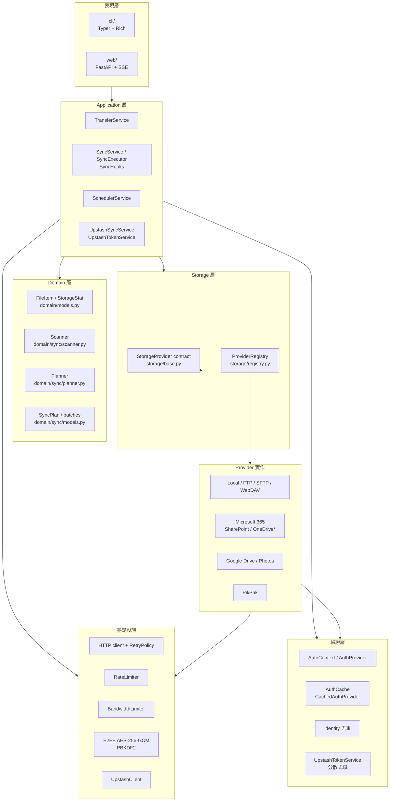
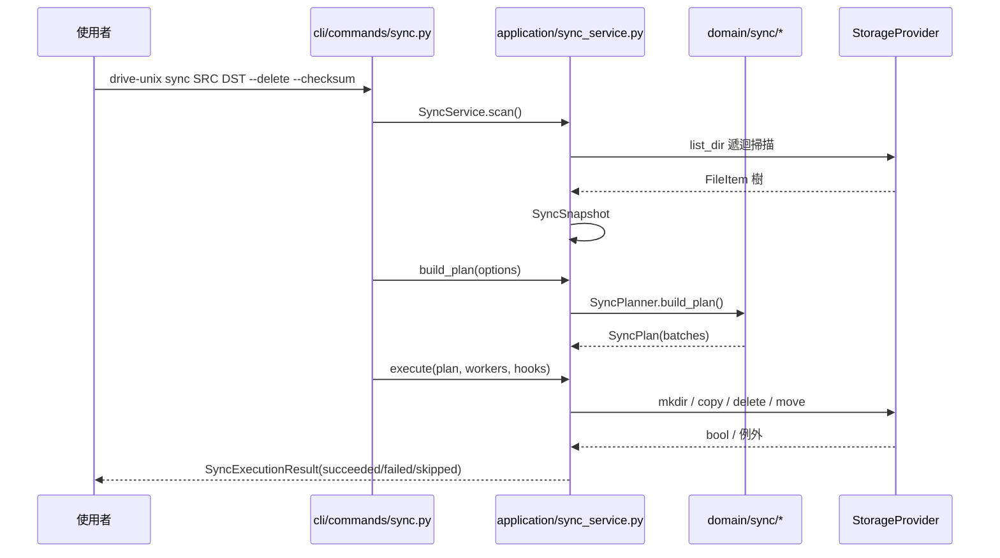
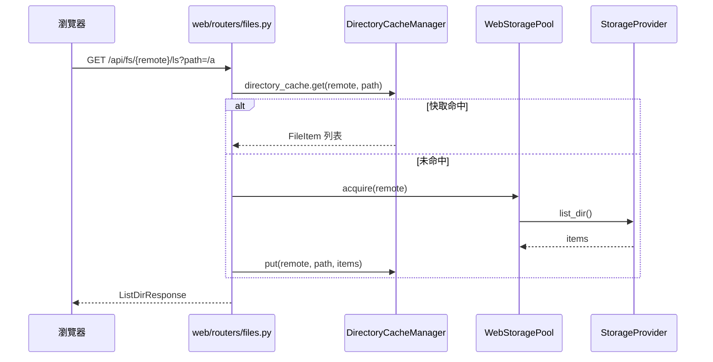
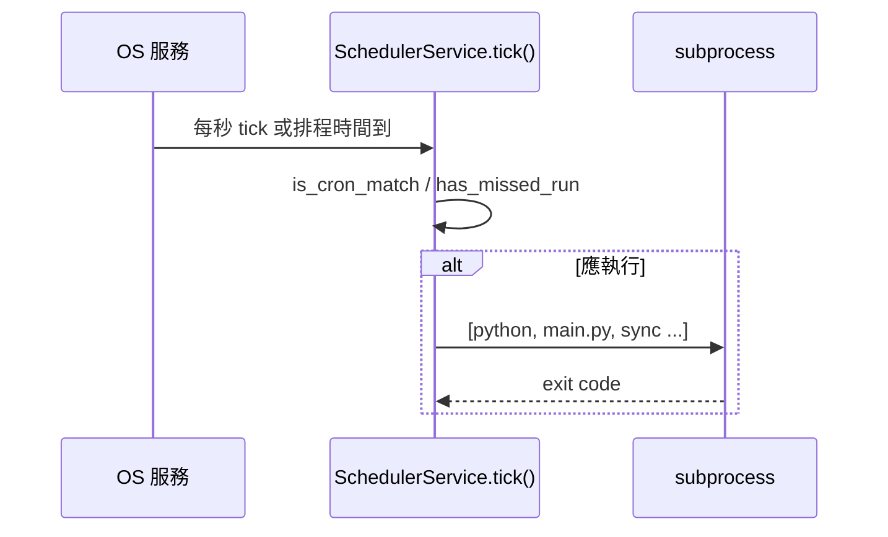
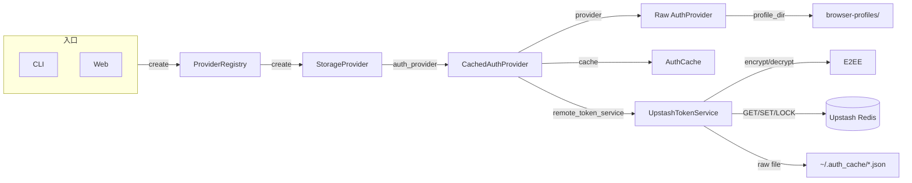

# 01 系統總覽與分層架構

## 1.1 分層

drive-unix 採嚴格分層，CLI 只做輸入解析與呈現，Application 做跨 Provider 協調，Domain 放純商業規則，Storage 以 contract + registry 區隔 Provider 細節。

| 層 | 職責 | 代表檔案 |
|---|---|---|
| CLI | 參數解析、互動提示、Rich 呈現、調 Application | `cli/app.py`, `cli/commands/*.py`, `cli/presentation.py`, `cli/context.py` |
| Application | 同步、跨 Provider 傳輸、排程、Upstash 同步協調 | `application/*.py` |
| Domain | Snapshot、Sync Plan、純商業規則（無 I/O） | `domain/models.py`, `domain/sync/*.py` |
| Storage | Provider contract、registry、統一列舉／上傳／下載／刪除 | `storage/base.py`, `storage/registry.py` |
| Providers | 各雲端／協定實作 | `providers/*.py`, `providers/microsoft365/client.py`, `providers/google/photos.py` |
| Infrastructure | HTTP、重試、限流、加密、Upstash 操作 | `infrastructure/*.py`, `core/crypto.py` |
| Auth | OAuth / Cookie 驗證、安全 cache、identity | `auth/*.py`, `auth/providers/*.py` |

## 1.2 呼叫鏈

### CLI 同步

### Web 瀏覽

### 排程觸發

## 1.3 核心物件

| 物件 | 定義 | 說明 |
|---|---|---|
| `FileItem` | `domain/models.py` | 檔名、path、is_dir、size、modified_at、thumbnail_url |
| `StorageStat` | `storage/base.py` | 單檔 stat 結果 |
| `AuthContext` | `auth/base.py` | headers / cookies / query_params / expires_at / metadata，刻意不預設驗證方式 |
| `SyncSnapshot` | `domain/sync/models.py` | `base_path + items{rel_path:FileItem} + complete` |
| `SyncPlan` | `domain/sync/models.py` | `SyncExecutionBatch` 序列，見第 05 章 |
| `SyncAction` | `domain/sync/models.py` | 9 種動作 `SyncActionType`，見第 05 章 |

## 1.4 元件關係速查

