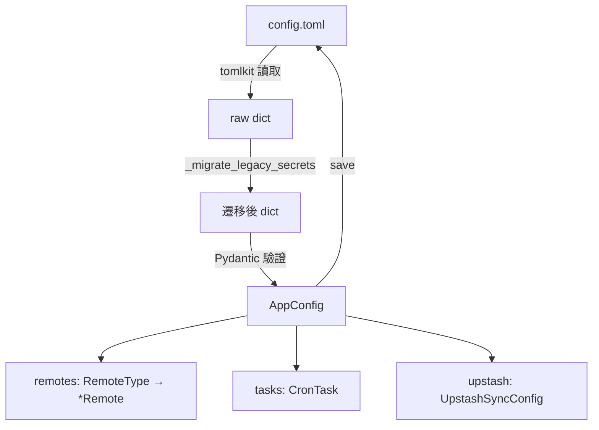
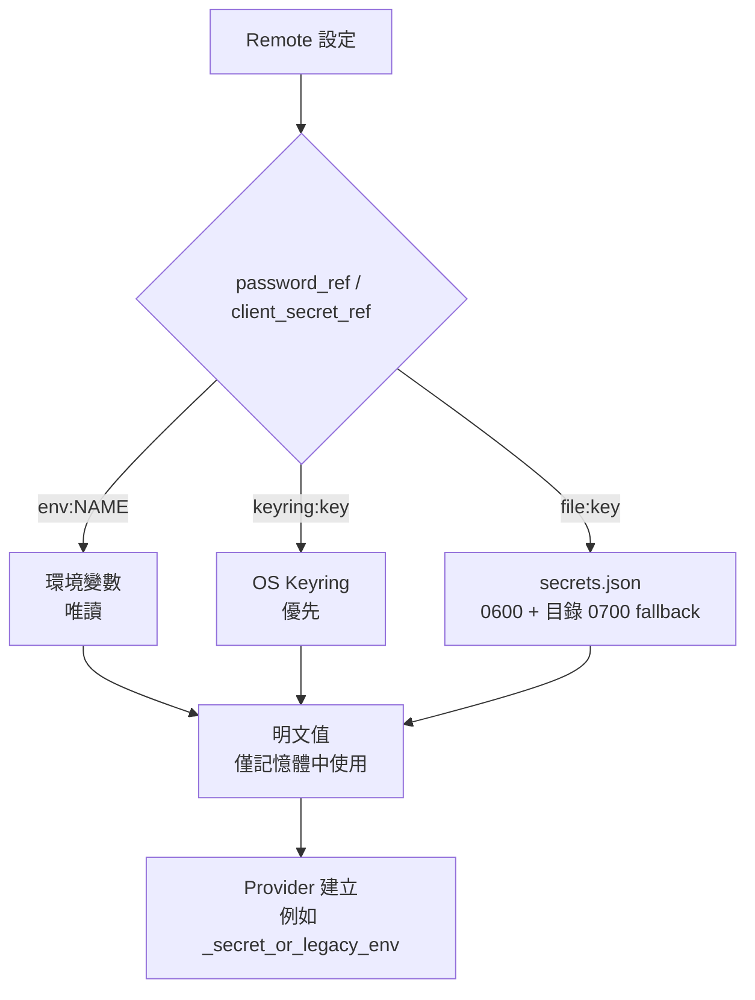
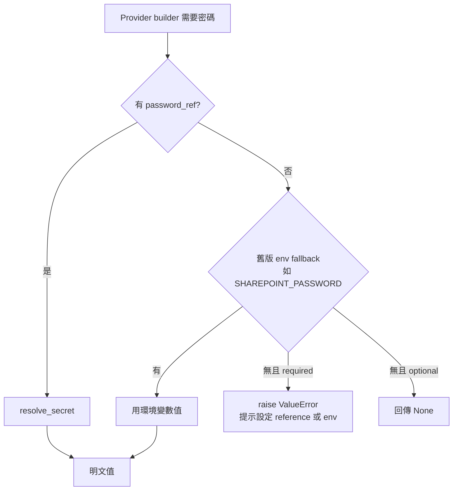

# 02 設定與密文管理

## 2.1 設定檔位置與結構

- 設定目錄：`DEFAULT_CONFIG_DIR`（見 `core/config.py`，`core/paths.py`），預設使用者家目錄下的 `drive-unix` 設定目錄。
- 主檔：`config.toml`，由 `ConfigManager` 用 `tomlkit` + Pydantic 讀寫，`save()` 以原子方式寫回（temp + rename）。
- Web 設定：`web_settings.json`，由 `WebSettingsManager` 管理（見第 08 章）。
- `AppConfig` 含：`remotes`、`tasks`（Cron）、`upstash`、`default_remote`。

### Remote 模型（`RemoteType` 11 種）

| 類型 | 模型 | 備註 |
|---|---|---|
| `sharepoint` | `SharePointRemote` | `base_url/site/email/password_ref/cache_source` |
| `onedrive_business` | `OneDriveBusinessRemote` | 同上欄位，與 SharePoint 共用 identity 規則 |
| `onedrive` | `OneDriveRemote` | `client_id/client_secret_ref/tenant` |
| `google_drive` | `GoogleDriveRemote` | `credentials_json/root_folder_id` |
| `googlephotos` | `GooglePhotosRemote` | `credentials_json`，token 路徑獨立 |
| `local` | `LocalRemote` | `root_path` |
| `ftp` | `FTPRemote` | `host/port/username/password_ref/tls/passive/root_path` |
| `webdav` | `WebDAVRemote` | `base_url/username/password_ref` |
| `sftp` | `SFTPRemote` | `host/port/username/key_filename/known_hosts/root_path` |
| `pikpak` | `PikPakRemote` | `username/password_ref/client_id/root_folder_id` |
| `alist` | `AlistRemote` | 型別保留，registry 報 `NotImplementedError` |

## 2.2 Secret Reference 機制

設定檔**絕不存明文**。`password` / `client_secret` 只以 reference 形式存在，Provider 建立時才由 `ConfigManager.resolve_secret()` 解析。

- `SecretRepository`（`core/secrets.py`）：service 名 `drive-unix`，`keyring` 優先、headless 才落 `file:`。
- `store_remote_secret()`：CLI 寫入新 secret 時先存入 store，再把 reference 寫回 `config.toml`。
- `environment_secret_ref()`：`--password-env VAR` 寫入 `env:VAR`。
- CLI 不再接受 `--password <明文>`；互動式用 hidden prompt，自動化用 `--password-env` / `--secret-env`。
- 舊版明文 `password` / `client_secret` 在首次載入時由 `_migrate_legacy_secrets()` 自動遷移到 store 並原子重寫 `config.toml` 移除明文。
- 刪除 Remote 時同步刪除其 `file:` / `keyring:` secret；`env:` 不修改程序環境。
- Google OAuth client credential files 放 `secret-files/`；`export-env` 預設排除 `secrets.json`。

### Provider 層的相容解析（`storage/registry.py::_secret_or_legacy_env`）

## 2.3 Upstash 設定

`ConfigManager.get_upstash_config()` 回傳 `(url, token, default_key)`，來源順序：環境變數 `UPSTASH_REDIS_REST_URL` / `UPSTASH_REDIS_REST_TOKEN` 優先，其次 `config.toml [upstash]`。`get_upstash_passphrase()` 取 E2EE passphrase（環境或設定）。`set_upstash_config()` 寫回。

## 2.4 權限 hardening

- cache 目錄 `0700`、cache 檔 `0600`（`AuthCache`、`_write_raw_file`、`chmod_best_effort`）。
- `secret-files/` 目錄 `0700`、檔案 `0600`。
- profile 目錄 `0700`（見第 03 章）。
- Upstash bundle 還原時 secret-files / auth_cache 亦重套 `0700` / `0600`。
