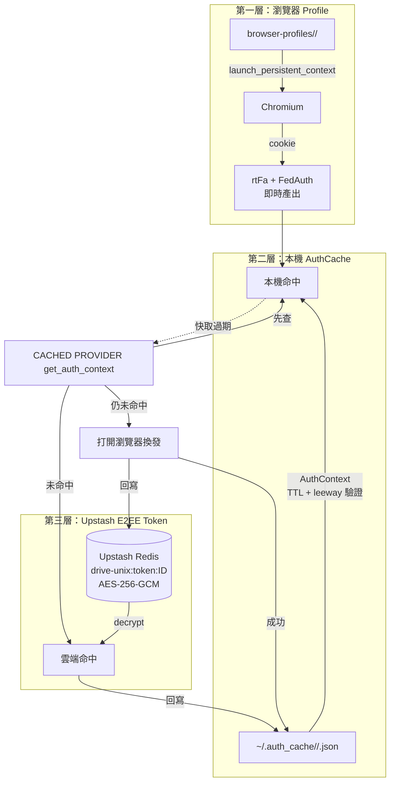
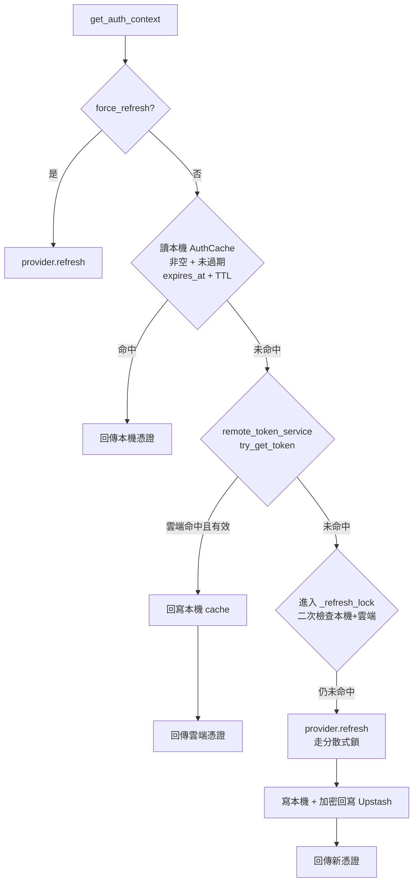
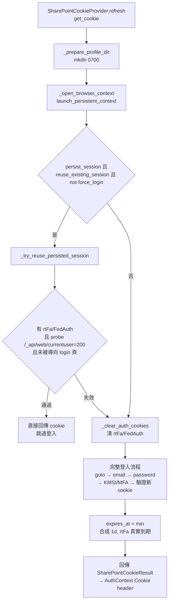
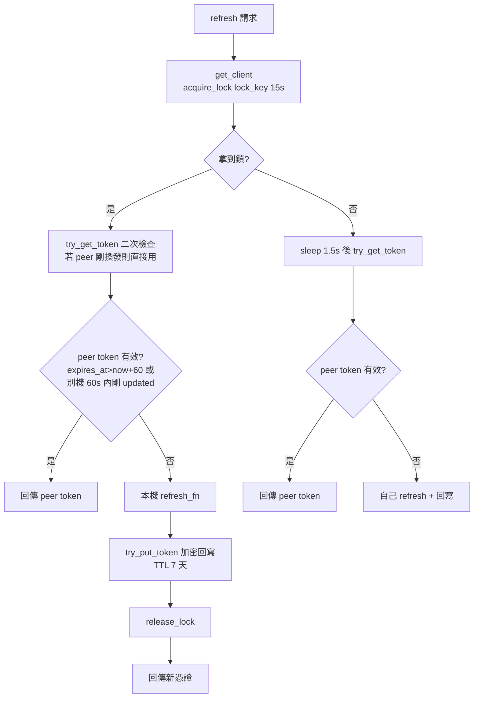
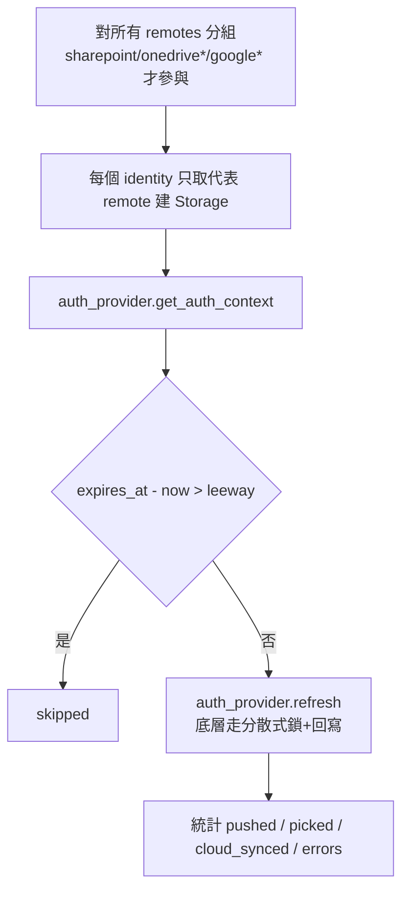

# 03 驗證與憑證

> 核心思想：**一個 identity、三層憑證**。多個 Remote 若共用同一帳號／租戶／OAuth client，必須去重成同一個 identity，三層憑證都以它為鍵。

## 3.1 Canonical Identity 去重

`auth/identity.py::get_canonical_auth_identity()` 決定「誰在跟誰共用憑證」：

```mermaid
flowchart TB
    R[Remote 設定] --> T{Remote 類型}
    T -->|SharePoint| A1[sharepoint:host:email<br/>host 取自 base_url netloc<br/>若有 cache_source 且非 sharepoint_main<br/>則用 cache_source]
    T -->|OneDrive Business| A2[sharepoint:host:email<br/>與 SharePoint 同規則]
    T -->|Google Drive/Photos| A3[google:client_id|檔名:type<br/>讀 credentials_json 內 client_id]
    T -->|OneDrive| A4[onedrive:client_id:tenant]
    T -->|其他| A5[type:remote_name<br/>各別 identity]
    A1 --> K[build_identity_cache_key<br/>SHA-256 hex 64 字]
    A2 --> K
    A3 --> K
    A4 --> K
    A5 --> K
```

- `build_identity_cache_key()` = `sha256(identity)`，同時用作：`AuthCache` 的 `cache_key`、Upstash 的 `drive-unix:token:{key}` / `drive-unix:lock:{key}`、Browser Profile 目錄名。
- 實測（伺服器）：7 個節點去重為 3 個 identity —— `ea1994…`（5 個 SharePoint）、`552e…`（OneDrive 商務 s96281）、`b837…`（b0831042）。

## 3.2 三層憑證全貌



## 3.3 取用與換發決策（`CachedAuthProvider`）

`auth/cache.py::CachedAuthProvider.get_auth_context()`：



- `AuthCache.is_valid()` 規則：① 必須有 auth material；② `expires_at` 未過期（含 `leeway_seconds`，預設 60s）；③ TTL 內（`metadata.cached_at + ttl`，預設 `DEFAULT_TTL_SECONDS=20h`；SharePoint／OneDrive Business 用 `DEFAULT_SHAREPOINT_EXPIRY_SECONDS=1d`）。
- `_sanitize_auth_context()`：讀取舊快取時剝離 `metadata` 中的 `access_token/refresh_token/client_secret/private_key/password/secret` 等敏感鍵。
- 寫入：temp 檔 + `os.replace` 原子替換 + `0600`。
- `refresh()` 走 `with_distributed_refresh_lock()`（見 §3.5），防止多機競態。
- `invalidate()`：刪除快取，供 401/403 時強制重登。

## 3.4 SharePoint Browser Profile

`auth/providers/sharepoint_cookie.py`：

| 項目 | 說明 |
|---|---|
| Profile root | `resolve_browser_profile_root()`：`DRIVE_UNIX_BROWSER_PROFILE_DIR` 顯式路徑優先；falsy 值（`0/false/no/off/none/disabled`）停用；否則 `DRIVE_UNIX_BROWSER_PROFILE_ENABLED=falsy` 停用；預設 `~/.config/drive-unix/browser-profiles` |
| Identity 目錄 | `<root>/<identity_key>`，`get_identity_profile_dir()`；一個 identity 一個目錄，**絕不跨 identity 共用**（Microsoft SSO cookie 以 host+name 為鍵，共用會覆寫彼此的 `esctx/AADSSO/uaid`） |
| 啟動方式 | `_open_browser_context()` 用 `launch_persistent_context`；若 profile 被其他行程鎖定（SingletonLock / already in use），降級為臨時 context 並警告 |
| 使用模式 | `reuse_existing_session=True`（預設）：先 probe，成功直接取 cookie；`force_login=True`：強制完整登入 |
| 實測 | 首次登入 12.67s；第二次沿用 0.74s，cookie 相同；profile 11.1 MB / 508 檔 |



備註：
- `_probe_sharepoint_session()` 用 `context.request.get(<base>/_api/web/currentuser, Accept: application/json;odata=nometadata)`，非 200 或被導向 `login.microsoftonline.com / login.live.com` 視為失效。
- 新登入若仍用 profile，KMSI（Stay signed in?）點 **Yes** (`idSIButton9`) 以拿 persistent `rtFa`；非 persistent 才點 No。
- 登入前清 stale `rtFa/FedAuth`，避免新 cookie 被 host-only vs 父域名的舊 cookie 遮蔽。
- `reset_profile()` 刪除該 identity 的 profile，密碼變更或 session 损坏時用。

## 3.5 Upstash Token 分散式鎖

`application/upstash_token_service.py::with_distributed_refresh_lock()`：



- Token key：`drive-unix:token:{identity_key}`，lock key：`drive-unix:lock:{identity_key}`。
- 回寫用 **100,000 iterations**（求快速交換）；一般 sync bundle 用 600,000。
- `try_get_token` 會一併還原 `raw_token_content`（例如 Google OAuth token 檔）到 `raw_cache_path`。
- `is_enabled` 需：`auto_sync_tokens != false` + URL + Token + Passphrase 都齊備，否則整段透明降級為純本機。

## 3.6 主動續期 `renew_all_tokens`

`UpstashTokenService.renew_all_tokens(leeway_minutes=30)`：



- 伺服器以 `drive-unix upstash renew-tokens --interval 1800 --leeway 60` 常駐（`drive-unix-renew.service`）。
- Web 也可 `POST /api/upstash/renew-tokens` 手動觸發。
