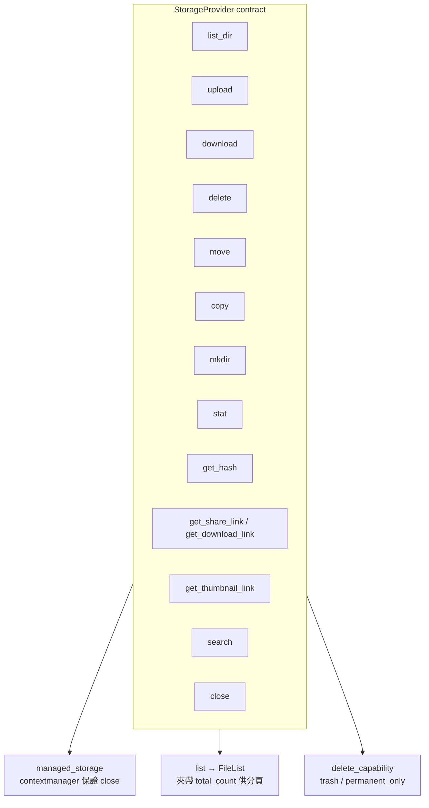
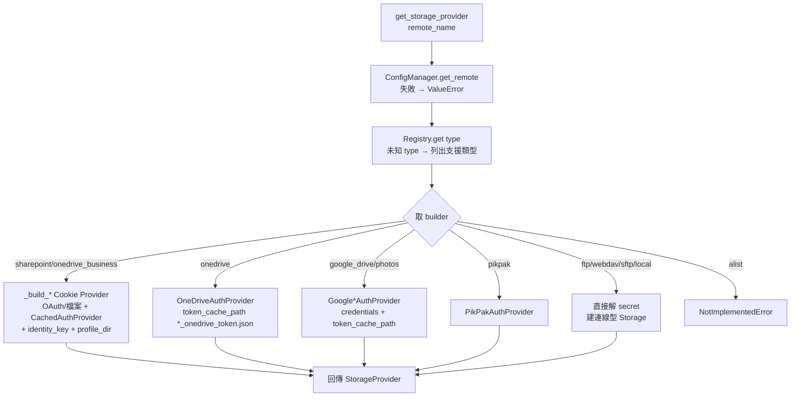
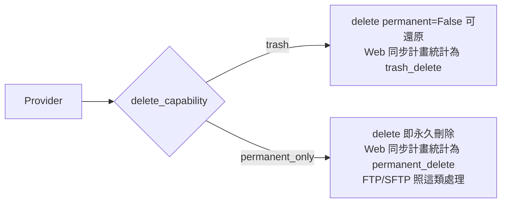

# 04 儲存 Provider

## 4.1 Contract：`StorageProvider`

`storage/base.py` 定義所有後端必須實作的抽象 contract、`DeleteCapability`、進度回呼與資料模型。

- `ProgressCallback = Callable[[int, int], None]`（transferred, total）。
- `FileList` 是 `list[FileItem]` 子類，可帶 `total_count`，Web 分頁直接用它決定總數或背景預熱。
- `managed_storage(provider)` contextmanager 在退出時呼叫 `provider.close()`，Web pool 時由 `PooledStorageProxy` 攔截以復用連線。

## 4.2 Registry 與建立流程

`storage/registry.py::ProviderRegistry`、`core/factory.py::get_storage_provider()`：

- 密碼走 `_secret_or_legacy_env()`（見第 02 章）：先 `resolve_secret(password_ref)`，再 fallback 舊版 env（如 `SHAREPOINT_PASSWORD`）。
- 需要 OAuth 的 Provider（OneDrive、Google）都會帶 `raw_cache_path`，讓 Upstash Token 同步能一併還原底層 raw token 檔。
- SharePoint／OneDrive Business 用 `DEFAULT_SHAREPOINT_EXPIRY_SECONDS`（1d）做 cache TTL。

## 4.3 各 Provider 一覽

| 類型 | 實作 | 驗證 | 刪除語義 | 備註 |
|---|---|---|---|---|
| `local` | `providers/local.py:LocalStorage` | 無 | 資料夾／檔案操作 | `root_path` 錨點 |
| `ftp` | `providers/ftp.py:FTPStorage` | 帳密 / anonymous | `PERMANENT_ONLY` | PASV/TLS 選項 |
| `sftp` | `providers/sftp.py:SFTPStorage` | 帳密或 key | `PERMANENT_ONLY` | `paramiko` |
| `webdav` | `providers/webdav.py:WebDAVStorage` | 帳密 | 視伺服器（trash／permanent） |  |
| `sharepoint` | `providers/sharepoint.py:SharePointStorage` + `microsoft365/client.py` | Cookie（Playwright） | `trash`（可還原） | `rtFa+FedAuth`，OAuth 互動在 `auth/providers/sharepoint_cookie.py` |
| `onedrive_business` | `providers/onedrive_business.py:OneDriveBusinessStorage` | Cookie（同上） | `trash` | 與 SharePoint 共 identity |
| `onedrive` | `providers/onedrive.py:OneDriveStorage` | Microsoft Graph OAuth | `trash` | `requests-oauthlib`，callback server 本地接 OAuth |
| `google_drive` | `providers/google_drive.py:GoogleDriveStorage` | Google OAuth | `trash` | `root_folder_id` |
| `googlephotos` | `providers/google/photos.py:GooglePhotosStorage` + `GooglePhotosClient` | Google OAuth（獨立 token） | `PERMANENT_ONLY` 傾向 | library 導向 |
| `pikpak` | `providers/pikpak.py:PikPakStorage` | PikPak 帳密自研 | — | `auth/providers/pikpak.py:PikPakAuthProvider` |
| `alist` | 未實作 | — | — | 型別保留 |

## 4.4 `DeleteCapability`

- `validate_delete_request(permanent)` 由 contract 預設實作，`permanent` 與 capability 矛盾時拒絕。
- Web `POST /api/sync/plan` 回傳 `permanent_delete_count / trash_delete_count` 供 UI 危險提示。
- `SyncPlanner` 刪除 Office 等破壞性動作會依 capability 區分批次（見第 05 章 §5.4 precondition/cleanup）。
