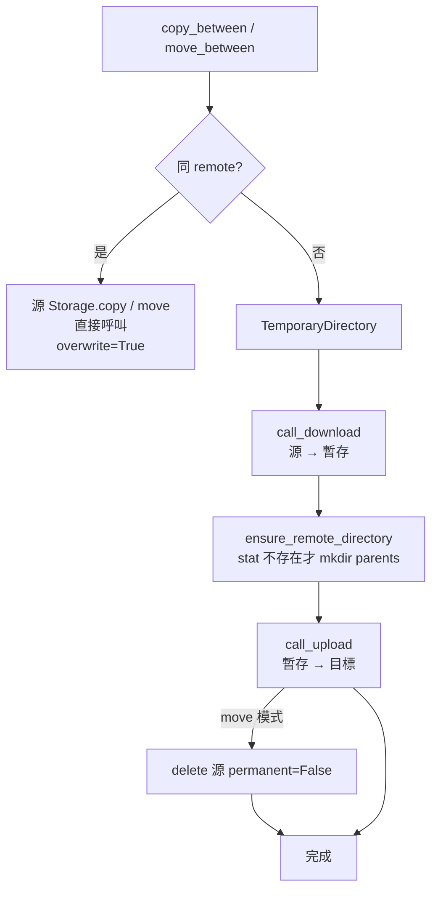
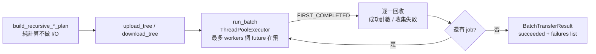
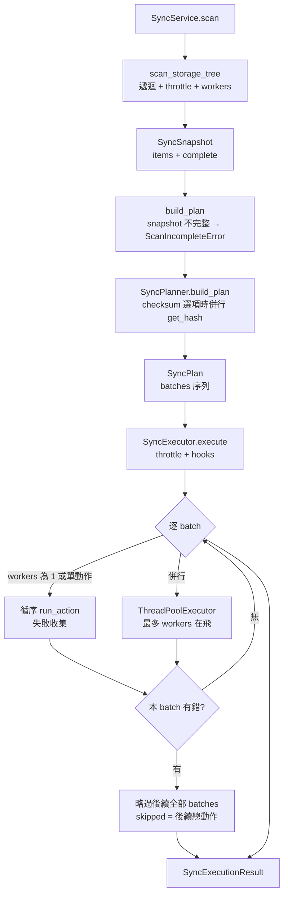
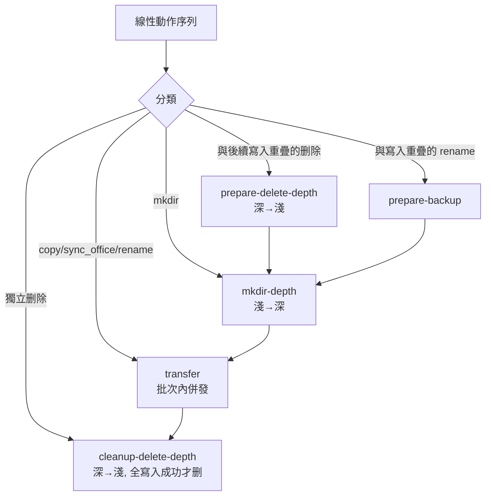

# 05 傳輸與同步資料平面

## 5.1 TransferService：跨 Provider 搬運

`application/transfer_service.py::TransferService` 是 CLI / Web / SyncExecutor 共用的搬運核心，**不含 UI 邏輯**，只回傳 `bool` 或丟 `TransferOperationError`。

- `call_upload/call_download`：Provider 回 `False` 即轉例外；上傳若來源消失補 `callback(0,0)`。
- `move_between` 失敗時機：下載成功、上傳失敗 → 來源不刪（move 只有上傳成功後才 `delete`）。
- `copy_between` 同 Remote 直接 `copy(..., overwrite=True)`，跨 Remote 建暫存。

### 遞迴上傳／下載與批次

- 上傳計畫：`os.walk` 展開，目錄空缺記 `empty_directories`；路徑 `remote_leaf == local_dir_name` 時不重複層。
- 下載計畫：`get_all_files_recursive` 掃遠端，本地同大小且非 `force` 即 `skipped`。
- 目錄建立以 `threading.Lock + known_directories` 去重，避免併發重複 `mkdir`。

## 5.2 SyncService：掃描 → 計畫 → 執行

- `scan`：同 Remote 兩邊循序；跨 Remote 用 `ThreadPoolExecutor(2)` 並行掃兩端。`scan_workers` 預設 4，`throttle` 預設 0.3s。
- `DIFF`（`--diff` / `diff_items`）：只計畫不執行，支援 `--checksum` 且僅 `local/sharepoint` 互比時走 `quickXorHash` 併行比對；`bisync` 為雙向。
- `SyncHooks`：`action_started / progress / action_finished / message`，token 用 `SyncActionToken` 關聯 UI 進度。

## 5.3 Scanner 與 Planner 分工

- `domain/sync/scanner.py::scan_storage_tree(storage, base, strict, throttle, max_workers, on_progress)`：遞迴列目錄，進度回呼，失敗時依 `strict` 決定丟 `ScanIncompleteError` 或標 `complete=False`。
- `domain/sync/planner.py::SyncPlanner.build_plan(source_items, destination_items, source_base_path, destination_base_path, source_type, destination_type, options, checksum_comparator)`：
  - 比對規則：路徑→存在性、大小、mtime、Office 副檔名（`OFFICE_EXTENSIONS`）、checksum。
  - `SyncOptions` 合法組合：雙向不允 `--delete`；`--conflict abort/prefer-destination` 只適用雙向；見 `models.py::validate()`。

## 5.4 SyncPlan batches 依賴屏障

`SyncPlan.from_actions()` 把線性動作序列按依賴切成 batches（見 `domain/sync/models.py`）：

- 重疊判斷：以 path 祖先／後代關係（`_overlaps_any`）判斷 delete/rename 是否會刪掉後續寫入目標。
- 執行時：批次內 `workers` 併發、**批次間嚴格順序**；任一 batch 失敗 → 後續全部略過並回報 `skipped`，避免半套寫入後繼續破壞。
- `SyncActionType` 9 種：`COPY_TO_DEST / COPY_TO_SRC / SYNC_OFFICE / MKDIR_DEST / MKDIR_SRC / DELETE_DEST / DELETE_SRC / RENAME_DEST / RENAME_SRC`。`SYNC_OFFICE` 雙跑 `copy_between`（先 dest→src 再回寫 src→dest）達成 Office 雙向內容同步。

## 5.5 執行動作映射

| 動作 | 實作（`sync_service.py::_execute_action`） |
|---|---|
| `COPY_TO_DEST / COPY_TO_SRC` | `TransferService.copy_between` |
| `SYNC_OFFICE` | 雙向 `copy_between` |
| `MKDIR_DEST / MKDIR_SRC` | `mkdir(parents=True)` |
| `DELETE_DEST / DELETE_SRC` | `delete(permanent=False)` + capability 檢查 |
| `RENAME_DEST / RENAME_SRC` | `move` |
