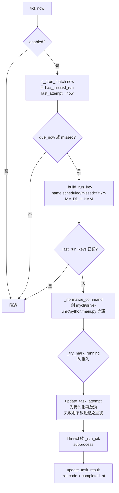
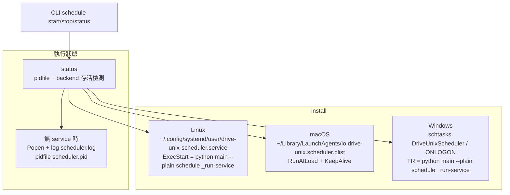

# 06 排程與常駐服務

## 6.1 Cron 規則（`application/scheduling.py`）

內建排程器使用 **5 欄 Cron**：`分 時 日 月 星期`，支援 `*`、`,`、步進 `/`、範圍 `-`。

| 函式 | 功能 |
|---|---|
| `validate_cron_expression()` | 必須 5 欄，否則 ValueError |
| `is_cron_match(expr, target)` | 本分鐘命中？星期以 `isoweekday() % 7` 及原始值雙比對 |
| `has_missed_run(expr, last_run, now)` | 上次執行後有無命中（前推 `MAX_SCHEDULER_LOOKBACK = 7 天` 逐分鐘爬） |
| `next_cron_occurrence(expr, after, horizon=366d)` | 找下一個命中（月→日／星期→時→分 逐層跳） |

## 6.2 SchedulerService（`application/scheduler_service.py`）

- `run_forever(sleep_interval=1.0)`：無限迴圈 `tick(now)`，外層 catch 防 daemon 崩潰拖累全部任務；單任務失敗不阻擋同 tick 後續任務。
- `tick`：逐任務 `_evaluate_task`（含 `run_key` 去重、`_last_run_keys` 按分鐘修剪）。
- `_run_job`：`subprocess.run([executable, script, *args], env PYTHONIOENCODING=utf-8, capture_output=True)`，獨立執行緒、daemon thread，結束後重讀 Config 寫 `last_run / last_result`（`_config_lock` 下避免併發覆蓋）。
- `emit(level,msg)`：`output` callback（CLI／Web 共用壞消息管道），完成自動丟 running 標記。

## 6.3 Daemon 生命週期（`application/scheduler_daemon.py`）

`SchedulerDaemonManager` 抽象三平台，把「常駐」交給 OS 服務；無 service 時自動退化為 detached 子行程。

| 操作 | Linux | macOS | Windows | 無 service |
|---|---|---|---|---|
| `install` | unit + daemon-reload + enable | plist | `schtasks /Create /ONLOGON` | 不支援 |
| `start` | `systemctl --user start` | `launchctl bootstrap/kickstart` | `schtasks /Run` | detached Popen |
| `stop` | `systemctl --user stop` | `launchctl bootout` | `schtasks /End` | SIGTERM → SIGKILL |
| `status` | pidfile + `is-active` | pidfile + `launchctl print` | pidfile（多語系狀態不穩） | pidfile |

- 共用執行緒：`SchedulerService.run_forever`。
- CLI 子指令：`schedule status/start/stop/restart`，工作項目增刪改查與 `schedule run <name>` 立即觸發。
- Web 對應：`POST /api/schedule/daemon/{start,stop,restart}` + `GET /api/schedule/daemon/status`（見第 08 章）。
- 伺服器部署的 `drive-unix-renew.service` 是另一條獨立 unit：`drive-unix upstash renew-tokens --interval 1800 --leeway 60`，不是 Cron scheduler（見第 11 章）。
