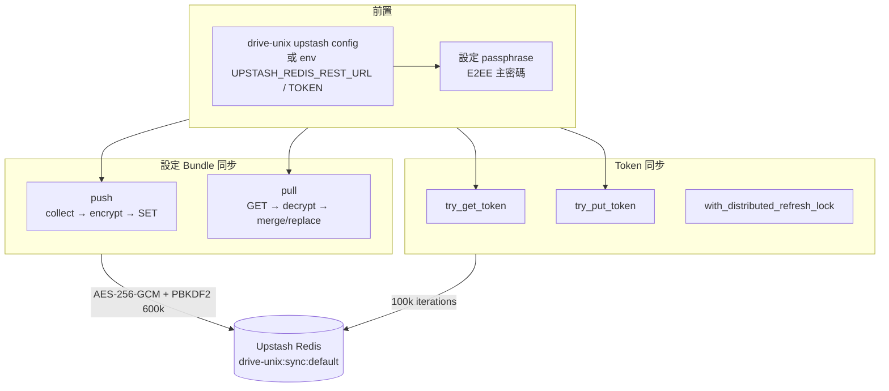
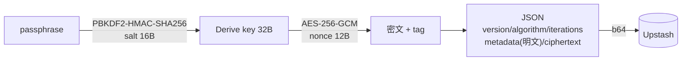

# 07 Upstash 雲端同步

> 兩種同步分工：**設定 Bundle**（remotes＋secrets＋secret-files＋可選 tasks/auth_cache）與 **Token 細粒度**（per-identity `AuthContext`，見第 03 章）。前者負責換機器，後者負責多機自動共用登入。

## 7.1 整體

### 7.1.1 多使用者隔離（Multi-User / Multi-Tenant）

同一個 Upstash / Redis 資料庫可同時支援多個使用者隔離使用：
- **設定 Bundle 鍵值**：`drive-unix:sync:<user>`（預設使用者為 `default`，即 `drive-unix:sync:default`；其他使用者如 `drive-unix:sync:user1`）。
- **Token 鍵值**：`drive-unix:token:<user>:<identity>`（預設使用者保持向下相容之 `drive-unix:token:<identity>`）。
- **分散式鎖鍵值**：`drive-unix:lock:<user>:<identity>`（預設使用者保持 `drive-unix:lock:<identity>`）。
- **清單探索**：藉由 `UpstashClient.keys("drive-unix:sync:*")` 可列出 Redis 雲端現有的全部使用者與備份包中繼資料（`list_users`）。

## 7.2 設定 Bundle：push / pull

`application/upstash_sync_service.py::UpstashSyncService`：

```mermaid
flowchart TB
    subgraph Push["push"]
        A["collect_sync_bundle"] --> B["remotes + secrets<br/>secret-files + tasks?<br/>auth_cache?"]
        B --> C["明文 JSON<br/>public_metadata:<br/>created_at/device/remote_names"]
        C --> D["encrypt_payload<br/>AES-256-GCM + PBKDF2"]
        D --> E["UpstashClient.set<br/>sync_key"]
    end
    subgraph Pull["pull"]
        F["UpstashClient.get"] --> G["decrypt_payload"]
        G --> H["dry_run?"]
        H -->|是| I["回傳 new/conflicting"]
        H -->|否| J["1. 還原 secret-files 0600/0700"]
        J --> K["2. secret 值寫入本機 store<br/>env: 維持引用跳過"]
        K --> L{"strategy"}
        L -->|merge| M["存在跳過除非 overwrite"]
        L -->|replace| N["先刪本機全部 remotes"]
        M --> O["重映射 ref → 新 store ref<br/>驗證 → 存入"]
        N --> O
        O --> P["回補 default_remote + tasks<br/>+ auth_cache 若有"]
        P --> Q["save"]
    end
    subgraph Status["fetch_status"]
        R["GET 只讀 metadata<br/>不解密"]
        R --> S["exists/version/algorithm<br/>created_at/device/remote_names<br/>對比 local_remotes"]
    end
```

- `collect_sync_bundle`：`app_config.remotes/tasks/default_remote` + `secrets{ref:值}` + `secret_files{name:內容}` + 可選 `auth_cache{rel:檔內容}`，版本 `version=1`、`created_at` UTC、`device_name` hostname。
- `push(iterations=600_000)`；`payload_size_bytes` 供回報。`fetch_status` 只看 `metadata` 不解密 secrets。
- `pull(strategy=merge|replace, overwrite, dry_run)`：`env:` reference 原樣保留（機器專屬）；其餘先 `put()` 入本機 store 取新 ref，再把 remote 內 `password_ref/client_secret_ref` 重映射。
- `delete_bundle()` 刪 Upstash 對應 key。

## 7.3 E2EE：`core/crypto.py`

- `encrypt_payload(plaintext, passphrase, metadata, iterations)`；`decrypt_payload(payload, passphrase)`，tag 不符 → `DecryptionError`，結構損毀 → `PayloadCorruptedError`。
- `DEFAULT_PBKDF2_ITERATIONS=600_000`；Token 回寫固定 `100_000`。
- metadata 公開：`created_at/device_name/remotes_count/includes_*/remote_names`（Bundle）或 `identity_key/device_id/updated_at/expires_at`（Token）—— 不含任何 secret。

## 7.4 UpstashClient（`infrastructure/upstash_client.py`）

| 方法 | 說明 |
|---|---|
| `get(key)` | GET 回 raw 字串或 None |
| `set(key, value, ex_seconds)` | SET，Token 用 `7 天 TTL` |
| `delete(key)` | 回刪除筆數 |
| `acquire_lock(key, owner, ttl=15s)` | 分散式鎖（SET NX EX），供 Token 換發用 |
| `release_lock(key, owner)` | owner 匹配才釋放 |
