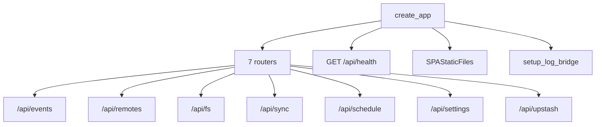
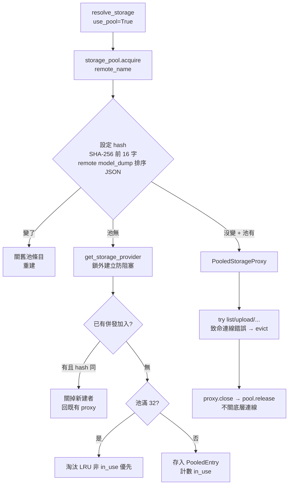
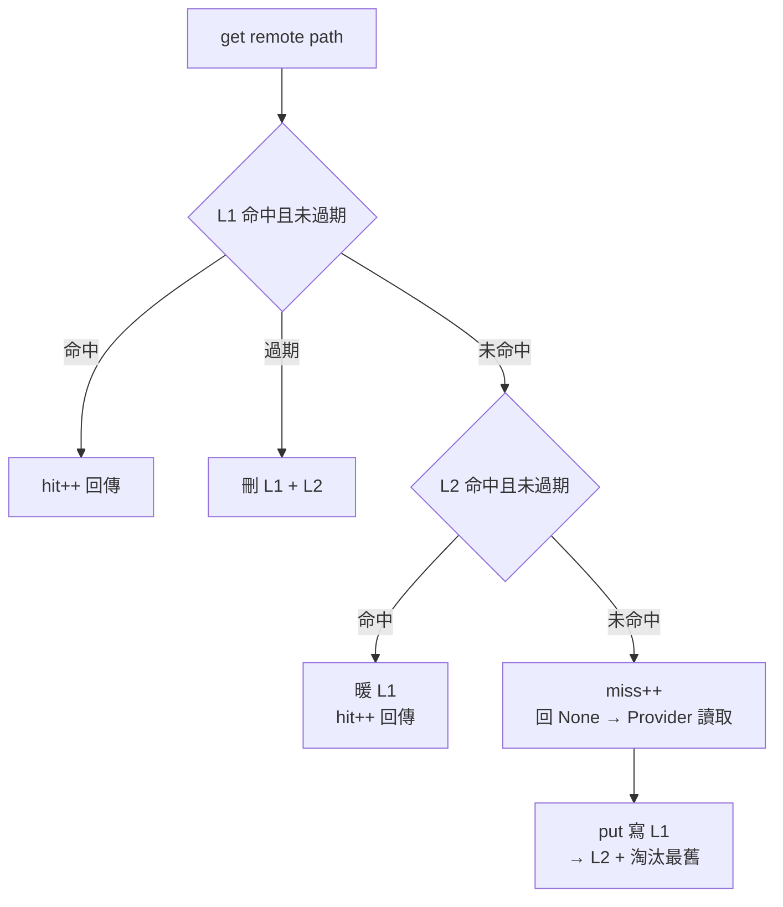
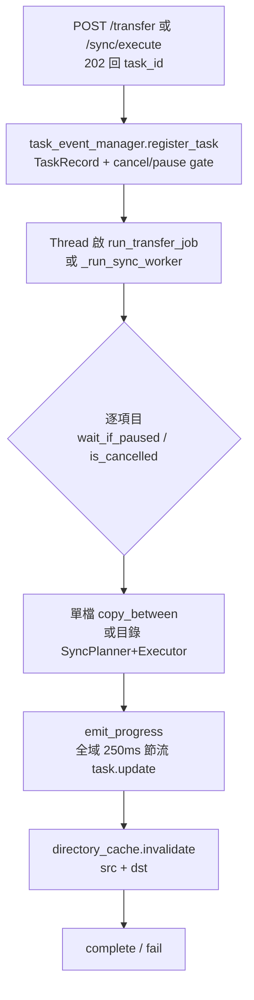
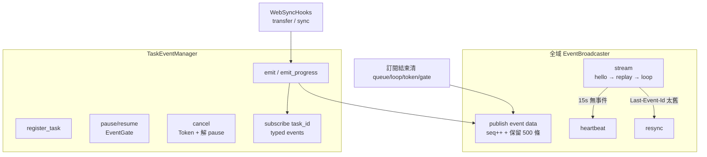

# 08 Web 介面

## 8.1 組裝（`web/app.py`）

`create_app()` 回傳 FastAPI，`lifespan` 關機時 `storage_pool.clear()`。CORS 允全 `^https?://.*$`。SPA 靜態時 `SPAStaticFiles` 對非 `api/` 的 404 回 `index.html`。

## 8.2 API 一覽

| 前綴 | 端點 | 說明 |
|---|---|---|
| `/api/fs` | `GET /{remote}/ls` | 目錄列表（快取 + 分頁 + 排序 + 背景預熱，見 §8.4） |
| | `GET /{remote}/stat`, `POST /{remote}/mkdir`, `POST /{remote}/delete` | 元資料、建目錄、刪除（`permanent` + capability 檢查） |
| | `GET /{remote}/download`, `GET /{remote}/read`, `GET /{remote}/raw` | 串流下載／文字讀／原始位元組 |
| | `GET /{remote}/link` + `GET /{remote}/download-link`, `GET /{remote}/thumbnail` + `GET /{remote}/thumbnail-link` | 分享／直鏈／縮圖連結（雙路徑相容） |
| | `POST /{remote}/upload` | 64KB 分塊寫 temp 再上傳，防記憶體爆增；`max_upload_size_mb` 限制 |
| | `POST /transfer` (202) | 跨節點批次傳輸（背景 task，見 §8.5） |
| | `POST /{remote}/rename|move|copy` | 同節點操作，成功後失效快取 + 發 `system` 事件 |
| `/api/remotes` | `GET/POST /`, `GET/PUT/DELETE /{name}`, `POST /{name}/disconnect|test`, `GET /{name}/quota` | 節點 CRUD 與連通測試 |
| `/api/sync` | `POST /plan`, `POST /execute` (202), `GET /tasks`, `GET /tasks/{id}/status`, `GET /tasks/{id}/events` (SSE), `POST /tasks/{id}/pause|resume|retry|cancel` | 同步預檢與背景執行 |
| `/api/schedule` | `GET/POST /`, `PUT/DELETE /{name}`, `POST /{name}/toggle|run`, `GET /daemon/status`, `POST /daemon/{start,stop,restart}` | Cron 任務與 daemon 生命週期 |
| `/api/settings` | `GET/PUT /`, `GET /cache/stats`, `POST /cache/clear`, `GET /connections`, `POST /connections/clear`, `GET /debug/screenshots*`, `GET /debug/mfa-status` | Web 設定、快取／連線池維運、登入除錯 |
| `/api/upstash` | `GET/POST /config`, `POST /test`, `GET /status`, `POST /push|pull`, `DELETE /`, `GET /tokens`, `DELETE /tokens/{identity_key}`, `DELETE /locks/{identity_key}`, `POST /renew-tokens` | 雲端同步管理 |
| `/api/events` | `GET /` (SSE) | 全域事件訂閱（hello / replay / heartbeat） |

## 8.3 連線池（`web/storage_pool.py`）

- `PooledStorageProxy._handle_call` 攔截 `ConnectionReset/Aborted/Refused/BrokenPipe/EOF/Timeout/paramiko.SSHException` → 淘汰該池條目。
- `PooledEntry` 含 `config_hash / created_at / last_accessed_at / access_count / in_use_count`；idle 逾時（預設 300s）才回收，且 `in_use>0` 絕不淘汰。`stats()` 回 hit ratio 供 `/connections`。
- 同步／傳輸背景工作用 `use_pool=False`（或 `managed_storage`），避免池裡的代理在大量併發時被借用。

## 8.4 目錄快取（`web/cache.py`）

`DirectoryCacheManager` 兩級：L1 記憶體 dict、L2 SQLite（`cache.db`，WAL + NORMAL）。

- TTL 預設 300s，`max_entries=1000` 滿時先清過期、再刪最舊 timestamp。
- `invalidate(remote, path)`：整 remote 或 `path` 子樹（含父目錄）失效，同步刪 L2（Web 寫操作後呼叫）。
- 縮圖快取獨立：TTL 取 `max(1800, ttl*6)`。
- warmup：啟動時讀 L2 最新 1000 目錄 + 2000 縮圖暖 L1；帶 `limit` 的 `ls` 未命中時 **背景非同步預熱完整目錄**（`ThreadPoolExecutor` + `_active_warmups` 去重），後續翻頁／排序 0 延遲。
- `GET /cache/stats` 回 hit ratio、持久化筆數、db 路徑。

## 8.5 傳輸與同步背景任務

- `web/transfer_jobs.py::run_transfer_job`：單檔走 `copy_between` + `bandwidth_limiter.consume`；目錄走 `SyncPlanner(one_way=True, delete=False, conflict=auto)` + `SyncExecutor(workers=4)`；`move` 模式成功後刪源。
- `web/routers/sync.py::WebSyncHooks` 把 `SyncExecutor` hooks 橋成 SSE：`action_start/done/error` 發 `task.log` 到全域 broadcaster，也發 task 專屬事件；每個 `progress` 檢查 pause/cancel，並以 ETA + EMA 速度回 `emit_progress`。

## 8.6 SSE 事件（`web/events.py`）

- `TaskRecord` 欄位：`kind(sync/transfer/renew)`、`status(running/pausing/paused/completed/failed/cancelled)`、`bytes_done/total`、`speed_bps`（EMA）、`eta_seconds`、`files_done/total`、`request_payload`（供 retry）。
- 全域 `GET /api/events`：`id: seq` + `Last-Event-Id` replay + 15s heartbeat；task 專屬 `GET /api/sync/tasks/{id}/events`。
- `GET /api/sync/tasks?limit=`、`GET /tasks/{id}/status` 供 UI 輪詢備援。

## 8.7 全域限速（`web/bandwidth.py`）

Token bucket：`capacity = limit_kbps*1024`，補充 `rate_bps = limit*1024/8`，不足時在鎖外 `sleep(deficit/rate)`。`0` 表示不限。Web 設定裡 `bandwidth_limit_kbps` 熱更新。

## 8.8 Web 設定（`web/settings.py`）

`WebSettings` 分 `cache/ui/security/transfer/connection_pool + extra_options` 五區，PUT 部分更新後 `save()` 同時套用：

- cache → `directory_cache.set_db_path()`（切 DB 會重暖）；
- transfer → `bandwidth_limiter.set_limit_kbps()` + log 等級 `setup_log_bridge()`；
- connection_pool → `storage_pool.enabled/idle_timeout/max_cached_remotes`。

## 8.9 除錯端點

- `GET /debug/screenshots` 列 `~/.config/drive-unix/debug` 下 SharePoint 登入截圖；`GET /debug/screenshots/{file:path}` 讀檔。
- `GET /debug/mfa-status` 讀 `mfa_challenge.json`（見 §3.4 MFA 流程）。
