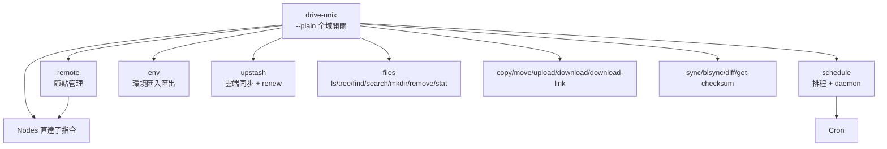
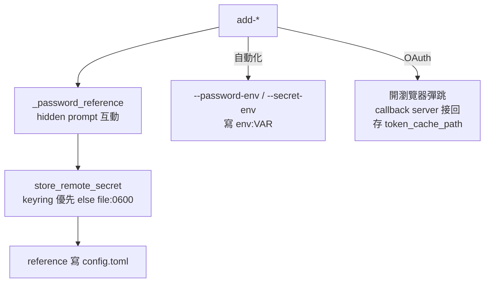

# 09 CLI

## 9.1 命令樹（`cli/app.py`）

- `--plain`：停用顏色／emoji／動態進度，`configure_presentation()` 處理（`cli/presentation.py`）；CI／log／screen reader 用。
- `ctx.color=False` 當 `--plain` 或 `NO_COLOR` 存在時。

## 9.2 各模組職責

| 模組 | 指令 | 呼叫的 Application |
|---|---|---|
| `files.py` | `ls`, `tree`, `find`, `search`（分頁／排序／遞迴模糊搜尋）, `mkdir`, `remove`, `stat` | 直接 `StorageProvider` + Rich 樹形／表格 |
| `transfer.py` | `copy`, `move`（跨 Provider 橋接）, `upload`, `download`（遞迴計畫＋併發＋`--workers`）, `download-link` | `TransferService`（計畫→執行），`Progress` 顯示 |
| `sync.py` | `sync`（單向）, `bisync`（雙向）, `diff`（預檢）, `get-checksum` | `SyncService` + `ProgressBarHooks` |
| `nodes.py` | `add-sp`, `add-onedrive-business`, `add-drive`, `add-photos`, `add-local`, `add-ftp`, `add-webdav`, `add-onedrive`, `add-pikpak`, `list`, `remove`, `rename`, `edit` | `ConfigManager` + `SecretRepository`（見第 02 章） |
| `cron.py` | `schedule add/list/remove/run`，`schedule daemon start/stop/status`，`_run-service` 內部指令 | `SchedulerService` + `SchedulerDaemonManager` |
| `environment.py` | `env export|import|export-env` | `UpstashSyncService` 的環境包（預設排除 `secrets.json`） |
| `upstash.py` | `upstash config|test|status|push|pull|delete|tokens|renew-tokens` | `UpstashSyncService` / `UpstashTokenService` |

## 9.3 密碼輸入與節點新增

- `nodes.py:_prompt_remote_provider` 互動時詢問 Provider 類型；密碼 reference 寫入後絕不保留明文在 `config.toml`。
- `list` 顯示節點表 + 類型；`remove` 同步刪 file/keyring secret；`edit` 保留原 reference 除非換值。

## 9.4 同步指令選項（`cli/commands/sync.py::_sync_impl`）

| 參數 | 預設 | 說明 |
|---|---|---|
| `--delete` | False | 僅單向生效（雙向強制拒絕） |
| `--conflict` | `auto` | `auto/newer/rename/abort/prefer-source/prefer-destination`；`abort*/prefer-destination` 僅雙向 |
| `--checksum` | False | 需兩端皆為 `local/sharepoint` |
| `--workers` | 4 | 執行併發 |
| `--scan-workers` | 4 | 掃描併發 |
| `--throttle` | 0.3 scan / 0 exec | API 節流秒 |
| `--dry-run` | — | 只印計畫不執行 |
| `--include/--exclude` | — | 路徑 pattern 過濾 |

## 9.5 傳輸指令

- `upload <local> <remote:path>` / `download <remote:path> <local> [--recursive] [--force]`。
- `copy/move <src_uri> <dst_uri>` 解析成 `(remote, path)`，經 `TransferService.copy_between/move_between`。
- 遞迴上傳下載用計畫：上傳先展開再併發；下載同大小跳過（非 force）。
