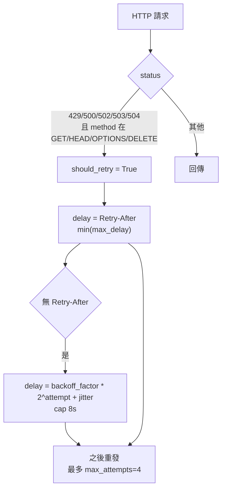
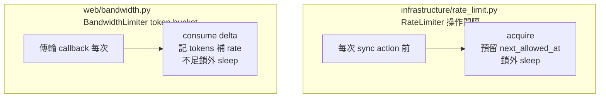

# 10 基礎設施與安全

## 10.1 HTTP 重試（`infrastructure/http/retry.py`）

`RetryPolicy`：指數退避 + `Retry-After` + jitter。

- `errors.py` 另定義 HTTP 錯誤 hierarchy 與逾時。

## 10.2 兩種限流

- `RateLimiter` 作用在同步「每次操作最小間隔」；`BandwidthLimiter` 作用在 Web 傳輸「全域位元組上限」。
- Web 同步 hooks 同時用兩者：`action_started` 前 `throttle.acquire`，`progress` 增量 `bandwidth_limiter.consume(delta)`。

## 10.3 加密（`core/crypto.py`，詳見第 07 章）

- PBKDF2-HMAC-SHA256（預設 600,000 iterations）派生 32B key；AES-256-GCM 加密，nonce 12B、salt 16B。
- Upstash Token 快換固定 100,000 iterations；設定 Bundle 600,000。
- 解密失敗分 `DecryptionError`（口令錯誤／竄改）與 `PayloadCorruptedError`（結構損毀），呼叫方只當「雲端不可用」降級，不崩潰主流程。

## 10.4 雜湊與路徑（`core/hashing.py`, `core/paths.py`）

- `build_cache_key`（`auth/cache.py`）：SHA-256（provider_type/source_name/account/resource/extra 排序 JSON），絕不含密碼／secret。
- `parse_remote_path`（`core/factory.py`）：`remote:path` 切分，無 `:` 用 `default_remote`。
- `core/constants.py` 集中超參：`DEFAULT_WORKERS/SCAN_WORKERS=4`、`SCAN_THROTTLE=0.3`、`BUFFER=64KB`、`MAX_SCHEDULER_LOOKBACK=7d`、`OFFICE_EXTENSIONS`、`MICROSOFT_PROVIDER_TYPES`。

## 10.5 權限與感知防護矩陣

| 資料 | 存放 | 權限 | 備註 |
|---|---|---|---|
| `config.toml` | 設定目錄 | 一般 | 只存 reference |
| `secrets.json` | 設定目錄 | `0600`／目錄 `0700` | keyring 不可用時 fallback；`export-env` 排除 |
| `secret-files/` | 設定目錄 | 檔 `0600`／目錄 `0700` | Google OAuth client JSON |
| `~/.auth_cache/**` | 家目錄 | `0600`／`0700` | AuthContext 快取；禁版控 |
| `browser-profiles/<id>/` | `~/.config/drive-unix/browser-profiles` | `0700` | Chromium 持久 session |
| Upstash Token | 雲端 | AES-256-GCM 明文不可見 | metadata 只有摘要；key 7 天 TTL |
| profile 截圖 | `~/.config/drive-unix/debug` | — | 登入成功自動清除，失敗保留供排查 |

## 10.6 錯誤處理原則

- Provider `return False` 永遠升級成例外（`TransferOperationError`／`RuntimeError`），不靜默成功。
- Upstash Token 讀寫失敗只 log + 降級本機，不阻擋備份流程（`renew` 端有 `sync_action: failed` 回報）。
- Web pool 致命連線錯誤才淘汰；一般例外往上丟成 HTTP 4xx/5xx。
- 排程單任務失敗不阻擋同 tick 後續任務；整 daemon 崩潰由外層 guard 兜底。
