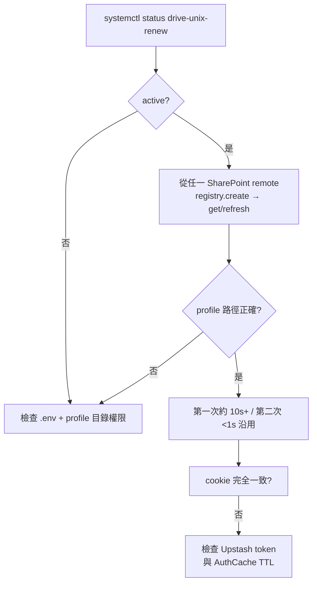

# 11 部署與維運

## 11.1 部署拓撲（伺服器 `35.209.66.156:/root/drive-unix`）

```mermaid
flowchart TB
    Repo[/root/drive-unix<br/>git main] --> WebUnit[drive-unix-web.service<br/>FastAPI uvicorn]
    WebUnit --> Health[GET /api/health 200]
    Repo --> RenewUnit[drive-unix-renew.service<br/>drive-unix upstash renew-tokens<br/>--interval 1800 --leeway 60]
    RenewUnit --> TokenFlow[renew_all_tokens<br/>分散式鎖 + profile 沿用]
    TokenFlow --> BrowserProfile[~/.config/drive-unix/browser-profiles/<id>]
    TokenFlow --> AuthCache[~/.auth_cache/**]
    TokenFlow --> Upstash[(Upstash E2EE Token)]
    WebUnit --> Pool[WebStoragePool + directory_cache]
    Env[/root/drive-unix/.env<br/>DRIVE_UNIX_BROWSER_PROFILE_DIR<br/>=/root/.config/drive-unix/browser-profiles]
    Env -.注入.-> WebUnit
    Env -.注入.-> RenewUnit
```

| Unit | 作用 | 重啟指令 |
|---|---|---|
| `drive-unix-web.service` | Web 伺服（瀏覽、同步、傳輸、排程控制、Upstash 管理） | `systemctl restart drive-unix-web` |
| `drive-unix-renew.service` | 每 30 分鐘主動續期 Token（leeway 60s） | `systemctl restart drive-unix-renew` |

## 11.2 環境變數

| 變數 | 說明 |
|---|---|
| `DRIVE_UNIX_BROWSER_PROFILE_DIR` | 顯式 profile root（伺服器設 `/root/.config/drive-unix/browser-profiles`）；falsy 停用 |
| `DRIVE_UNIX_BROWSER_PROFILE_ENABLED` | profile 總開關（falsy 停用） |
| `SHAREPOINT_PASSWORD` 等 `*_PASSWORD` | legacy fallback（有 `password_ref` 時優先） |
| `SHAREPOINT_SCREENSHOT_DIR` / `DRIVE_UNIX_DEBUG_DIR` | 失敗截圖目錄 |
| `UPSTASH_REDIS_REST_URL` / `UPSTASH_REDIS_REST_TOKEN` | Upstash REST 存取 |
| `UPSTASH_PASSPHRASE` | E2EE passphrase（相當） |
| `PLAYWRIGHT_NODEJS_PATH` | 本機 Windows 需指向 `node.exe` |
| `NO_COLOR` | CLI 停色 |

- `.env` 備份：`/root/.env.bak.20261108-125652`（600），repo 內只剩未追蹤的 `.env`，不得 commit。
- `upgrade` 前切回 root／定版：備份 `.env` 後更 `DRIVE_UNIX_BROWSER_PROFILE_DIR`，restart 兩 unit，確認 `ProfileDir` 正確。

## 11.3 維運檢查清單

### 登入續期



- 實測基準（見第 03 章）：首次 12.67s、沿用 0.74s；目前只建立了 `ea1994…`，其他 identity 會在各自下次換發時新建。
- profile 目錄權限 700；root 的 `~/.config/drive-unix` 亦 chmod 700。

### Web 健康

- `GET /api/health` 回 200。
- `GET /api/settings/connections`（pool stats：cached_remotes、hit_ratio、idle_seconds）與 `GET /api/settings/cache/stats`（hit ratio、persisted_dirs/thumbs）。
- Web 失效先清快取 `POST /cache/clear`、再清連線 `POST /connections/clear`。

### 失敗排查

| 現象 | 優先檢查 |
|---|---|
| SharePoint 登入失敗 | `~/.config/drive-unix/debug/sharepoint_session_*` 連環截圖；`GET /debug/mfa-status`；Conditional Access／MFA |
| `profile 正被使用` | 同 identity 不可並行換發；等 renew 結束或建議改跑序列 |
| Token 雲端回寫失敗 | passphrase 是否一致；`GET /api/upstash/status`（`cloud_enabled` + reason）；`POST /test` |
| 同步半失敗 | `GET /tasks/{id}/status` 的 `failed/skipped` + `task.log`；批次失敗會自動略過後續，需修好後 `retry` |
| 排程沒跑 | `scheduler_daemon` status；`is_cron_match` 結果；換最小 interval 單任務測試 |

## 11.4 備份與升級

- 備份／還原：`drive-unix upstash push / pull`（見第 07 章）；token 備份另由 `renew` 自動回寫。
- 升級 repo 時保留 `.env`（profile dir / Upstash / passphrase）不進 Git。
- 阿拉貝爾：`docs/DEPLOYMENT.md` 與 `docs/vps-deployment-token-center.md` 既有部署筆記；本章只摘要維運入口，不重寫完整 SOP。
