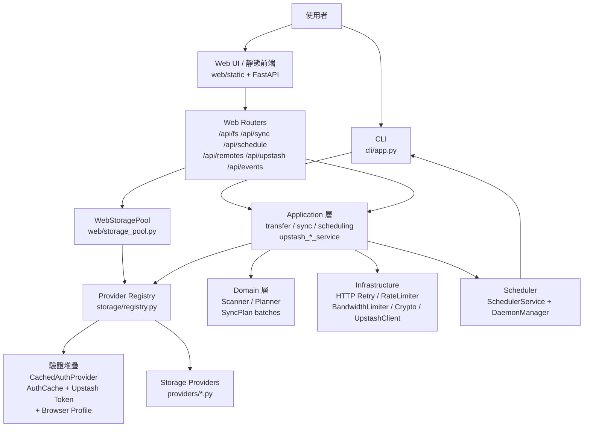

# drive-unix 機制文件總覽

> 本目錄是 drive-unix 全部機制的分類說明。每個章節對應一個子系統，必要時附 Mermaid 流程圖，並標註實際檔案與類別。
> 本文件依實際程式碼與已驗證行為撰寫，不凭空推測。

## 文件地圖

| 章節 | 主題 | 關鍵檔案 |
|---|---|---|
| [01 系統總覽與分層架構](01-system-overview.md) | 分層、AList/ 聚合、CLI/Web/Application 呼叫鏈 | `cli/app.py`, `application/*`, `domain/*`, `storage/*`, `web/app.py` |
| [02 設定與密文管理](02-configuration-and-secrets.md) | `config.toml`、secret reference、legacy migration、Upstash 設定 | `core/config.py`, `core/secrets.py`, `core/paths.py` |
| [03 驗證與憑證](03-authentication-and-credentials.md) | identity 去重、AuthCache 三層、Upstash Token 分散式鎖、SharePoint Browser Profile、OAuth | `auth/base.py`, `auth/cache.py`, `auth/identity.py`, `application/upstash_token_service.py`, `auth/providers/sharepoint_cookie.py` |
| [04 儲存 Provider](04-storage-providers.md) | `StorageProvider` contract、Registry、11 種 Remote 類型、DeleteCapability | `storage/base.py`, `storage/registry.py`, `providers/*` |
| [05 傳輸與同步資料平面](05-transfer-and-sync.md) | TransferService、SyncService/Executor、Scanner/Planner、Office 同步、checksum | `application/transfer_service.py`, `application/sync_service.py`, `domain/sync/*` |
| [06 排程與常駐服務](06-scheduling-and-daemon.md) | Cron 規則、SchedulerService、SchedulerDaemonManager（systemd/launchd/Task Scheduler） | `application/scheduling.py`, `application/scheduler_service.py`, `application/scheduler_daemon.py` |
| [07 Upstash 雲端同步](07-upstash-sync.md) | 設定 Bundle E2EE 同步（push/pull/merge/replace） | `application/upstash_sync_service.py`, `core/crypto.py`, `infrastructure/upstash_client.py` |
| [08 Web 介面](08-web-interface.md) | FastAPI 路由、Storage Pool、Directory Cache、傳輸 Job、SSE 事件、限速、設定 | `web/app.py`, `web/storage_pool.py`, `web/cache.py`, `web/events.py`, `web/routers/*` |
| [09 CLI](09-cli.md) | Typer 指令樹、files/transfer/sync/nodes/cron/env/upstash | `cli/app.py`, `cli/commands/*`, `cli/context.py` |
| [10 基礎設施與安全](10-infrastructure-and-security.md) | HTTP Retry、RateLimiter、Bandwidth Limiter、E2EE、權限 hardening | `infrastructure/*`, `core/crypto.py`, `core/config.py` |
| [11 部署與維運](11-deployment-and-operations.md) | Web/Renew systemd unit、profile 目錄、env 變數、維運檢查 | `docs/DEPLOYMENT.md`, `application/upstash_token_service.py`, `auth/providers/sharepoint_cookie.py` |

## 全系統總覽圖

## 核心設計原則

1. **一個 identity、三層憑證**（見 [03](03-authentication-and-credentials.md)）：Browser Profile → 本機 `AuthCache` → Upstash E2EE Token。同一身份禁止共用 Profile 目錄。
2. **設定只存 reference**（見 [02](02-configuration-and-secrets.md)）：`config.toml` 不保存明文密碼，只存 `env:` / `keyring:` / `file:` 引用，Provider 建立時才解析。
3. **計畫與執行分離**（見 [05](05-transfer-and-sync.md)）：`SyncService.scan → build_plan → execute`，計畫以 batches 做依賴屏障，批次內併發、批次間嚴格順序。
4. **同 Remote 直通、跨 Remote 橋接**（見 [05](05-transfer-and-sync.md)）：`copy_between/move_between` 判斷是否同 Remote。
5. **Pool + Cache 是 Web 效能核心**（見 [08](08-web-interface.md)）：`WebStoragePool` 復用連線、`DirectoryCacheManager` 兩級快取，寫入後精確失效。
6. **零信任雲端**（見 [07](07-upstash-sync.md)）：Upstash 只看到 `AES-256-GCM + PBKDF2` 密文，metadata 只含非敏感統計；Token 同步用分散式鎖避免競態。

## 建議閱讀順序

- 新人：01 → 02 → 03 → 04 → 09 → 08
- 維運／部署：11 → 03 → 06 → 07
- 除錯同步／傳輸：05 → 08（SSE）→ 10
